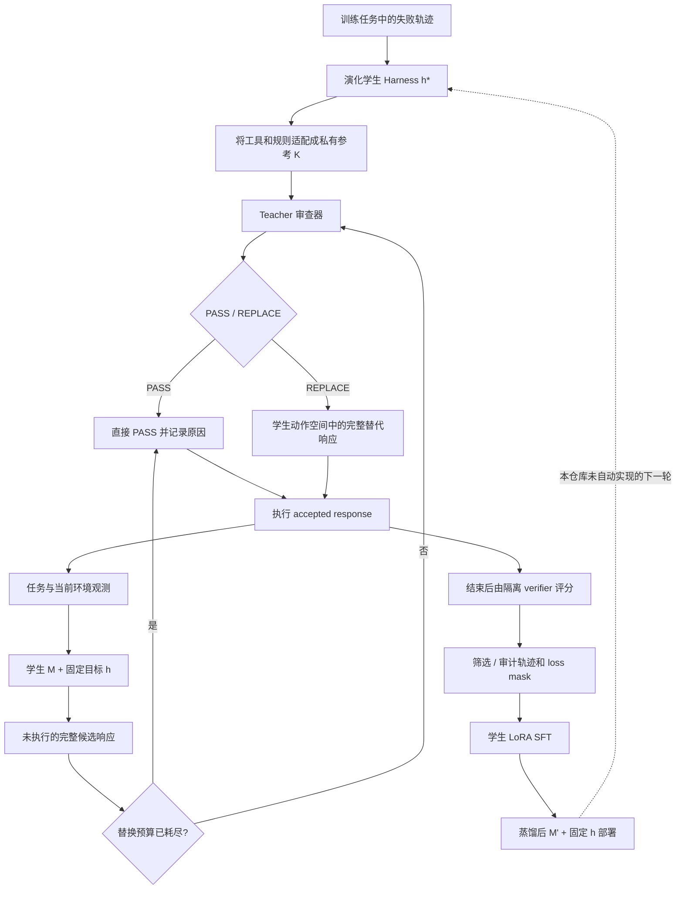

# Harness-Zero：代码架构、蒸馏数据链与实验工作流分析

> 面向：刚进入 Agent 长程推理方向的研究生。阅读目标：理解代码怎样承接论文方法，并判断哪些部分能够用于“演化长程 Harness → 分段审查 → SFT → 下一轮改进”的研究方案。
>
> 分析日期：2026-10-20。对象为本地 `harness-zero-main` 源码快照。本文没有运行训练、模型 API、Docker、基准评测或 pytest；结果数字均为作者报告，不能视为本次复现结果。

阅读导航：先读第1、3、4节建立方法和代码映射，再读第6、7节理解训练与评测；第11节集中讨论你的研究方案。配套的 [HyperAgents 分析](HyperAgents_代码架构与实验工作流分析.md) 解释改进器代码如何演化与继承。

## 1. 先建立整体认识

**Harness-Zero 最适合被理解为一个“把外部工作流转成学生可学习轨迹”的系统。** 它先有一个增强学生运行过程的 Harness，再把该 Harness 改写成教师私有的审查参考材料。学生每次提出响应时，审查者可以保留响应，或把它替换成学生原有动作接口能够执行的完整响应。随后用这些轨迹做监督学习。部署时取走审查者，检验学生权重是否学会了相应行为。[README][readme]、[实际审查入口][student126]与[训练更新][train276]共同支撑这一概括。

这和你的[研究笔记][note]第 3.1 节已经很接近。但需要修正两个认识：

1. **这里的蒸馏不是标准的教师 token 分布匹配。** 仓库不要求教师 logits，也没有逐 token KL 蒸馏；实际目标是 accepted response 的交叉熵 SFT。可以说它“在学生交互诱导的状态上在线采集教师审查数据”，但不宜直接把它当成标准 OPD 实现。[train.py:276][train276]；论文 §3.3，PDF p.5。[论文][paper]
2. **这里没有完成你设想的自动多轮 RSI。** 仓库有 Harness 演化、适配与蒸馏的接口及操作说明，但主 CLI 只有 rollout、数据构建、SFT 三项操作，没有自动更新改进器、合成长程课程、延长 horizon、再演化新 Harness 的完整驱动器。论文 §5（PDF p.9）把进一步形成 RSI 循环列为未来方向。[CLI][cli13]、[演化说明][evolve16]、[论文][paper]

因此，它对你最大的价值是提供**“能力内化”的中间层**：把私有工具、流程规则、记忆和中间件，转成固定目标动作空间里的可训练示范。它不能直接提供“RSI 导致长程推理增强”的实验证据。

### 1.1 术语对照：不要把三种 Harness 混为一谈

| 名称 | 是什么 | 存放/实现位置 | 在哪个阶段使用 |
|---|---|---|---|
| 学生模型 `M` / `πθ` | 负责生成下一个响应的语言模型；论文蒸馏目标为 Qwen3.5-9B | 模型通过 Harbor 参数指定；本地没有对应权重 | 采集、SFT、部署 |
| 目标 Harness `h` | 固定系统提示、一个原生 `execute` 工具、交互循环；bash 中另可调用 `agent` 子代理命令 | `student.py`、`prompts/student.md` | 采集与部署保持一致 |
| 演化学生 Harness `h*` | 给学生增加真实工具、中间件、技能与记忆的增强包 | `harness_bank/<domain>_student/`，`manifest.json` + `registry.py` | Harness 演化、直接挂载对照 |
| 私有参考 Harness `K` | 把 `h*` 改写为教师能阅读/触发的诊断规则和动作配方 | `harness_bank/<domain>/`，`index.json`、Markdown、review middleware | 训练数据采集时私有 |
| Teacher / harnessing agent | 读取 `K`，审查学生候选响应的模型代理 | `DeepAgentReviewer` | 采集；蒸馏后部署移除 |
| `PASS` | 接受原始响应；不会自动判断任务最终正确 | `ReviewSubmission` | 单次候选审查 |
| `REPLACE` | 给出完整学生响应：reasoning、content、最多一个 `execute` | `AssistantResponse`、`ReviewSubmission` | 单次候选审查 |
| SFT | 对筛选后的轨迹中 assistant token 做监督更新 | `sft.py`、`train.py` | 更新学生 LoRA 参数 |
| OPD | 通常指 on-policy distillation，但具体损失与教师接口因工作而异 | 此仓库没有 logits/KL 训练链 | 用于概念比较，不能替代代码事实 |

证据入口：[学生基础提示][studentprompt]、[学生 Harness 加载器][studenth89]、[审查数据契约][review24]、[教师代理][teacher111]。这里“一个工具”指**原生模型工具 schema**；bash 本身可运行脚本和子代理，所以不等于执行能力只有一个不可分解动作。

### 1.2 一张图看懂方法和可继承资产



**关键限定：默认调用路径不是“全程每步都由 Teacher 判断”。** `student.py:174` 在替换次数达到上限时直接构造 `PASS`，理由是 `replacement budget exhausted; candidate passed without review`。已经用完预算后，剩余步骤继续执行，却不再调用 Teacher。实验中必须同时统计总回合数、实际审查回合数和预算耗尽位置。[预算分支][student174]

## 2. 本次分析边界与证据等级

本文使用四种标记区分论断来源：**【代码核验】**表示读到具体实现；**【作者报告】**表示 README/论文声明；**【推断】**表示根据实现推导但未运行验证；**【建议】**表示为你的研究提出的扩展设计。没有把仓库中的操作型 `SKILL.md` 当作本次需要执行的命令。

本地目录没有 `.git`，`git rev-parse HEAD` 返回“not a git repository”，因而**无法提供可靠 commit**；目录名 `main` 不能代替 commit。用于识别当前快照的 SHA256：

```text
README.md
32778C69632AEA99A53F07CECD94141FC894BC90A7FC9BAD05FB938A9FBBB134
uv.lock
E7D3A1BCA43DF56AF98AAFD8578C35104C93CCB753654FF1933CA4B168291912
```

覆盖范围：通读核心 `src/harness_zero/` 的采集、审查、存储、数据构建与训练链；检查 Harbor 适配层的运行/执行/日志接口；检查三领域 bank 的索引、manifest 和主要注册点；检查 AppWorld 专用初始化、隔离评分及采集审计；抽读 SpreadsheetBench/USPTO 的实际 task verifier 与测试。没有逐个审计 1,732 个任务，也没有逐行审计 vendored deepagents 的全部实现。任务总数 400 + 732 + 600 是本次目录静态计数，不是模型评测。

## 3. 项目架构：研究方法如何被分层

```text
harness-zero-main/
├── pyproject.toml / uv.lock          # Python依赖、CLI入口、固定依赖快照
├── src/
│   ├── harness_zero/                # 方法主干
│   │   ├── cli.py / rollout.py      # 参数解析与Harbor任务编排
│   │   ├── harness.py               # Harbor Agent入口、私有Teacher工作区
│   │   ├── student.py / tools.py    # 固定学生工具循环与执行前审查
│   │   ├── review.py                # 候选响应/审查结果的强类型边界
│   │   ├── teacher.py               # 有持续会话的Teacher代理
│   │   ├── teacher_guidance.py      # 候选级私有中间件提示
│   │   ├── teacher_models.py        # 各模型提供方、并发限制
│   │   ├── student_harness.py       # h*的manifest/registry动态加载
│   │   ├── store.py                 # 原始候选、accepted轨迹、私有资产
│   │   ├── sft.py / dataset_utils.py# 轨迹筛选、格式转换、隐私检查
│   │   ├── chatfmt.py / chat_model.py# 推理内容与模型协议对齐
│   │   ├── train.py                 # Tinker LoRA SFT
│   │   ├── agent_cli.py             # bash可调用的一层子代理
│   │   └── prompts/                # 学生/Teacher/SFT/Oracle提示
│   └── deepagents_harbor/
│       ├── base.py / backend.py     # LangGraph↔Harbor↔Docker
│       ├── trajectory.py           # ATIF轨迹与原始调用sidecar
│       ├── message_content.py      # reasoning/text/tool规范化
│       └── .local_deps/deepagents/ # vendored固定副本
├── harness_bank/
│   ├── empty/                      # bare对照的空组件索引
│   ├── spreadsheetbench_student/   # 演化学生包 h*
│   ├── spreadsheetbench/           # Teacher参考 K
│   ├── appworld_student/ / appworld/
│   └── uspto_student/ / uspto/
├── envs/appworld/                  # 专用Agent、环境、服务、训练数据审计
├── data/
│   ├── spreadsheetbench-verified/ # 400个任务+300/100划分
│   ├── appworld-harbor/            # 732个任务+147/168/417划分
│   └── uspto/                     # 600个任务+500/100划分
├── .agents/skills/                # 演化/适配操作说明，并非自动演化调度器
├── tests/                        # 核心本地测试
└── assets/                       # README图
```

### 3.1 三个最重要的工程边界

**任务执行与模型决策分开。** Harbor 管理 task、容器、重试和 verifier；LangChain/LangGraph 构建学生/Teacher 循环；`HarborSandboxBackend.aexecute()` 才真正把命令交给环境。模型在宿主 Harbor 进程一侧调用，不是在 Docker 中启动一个训练中的语言模型。[base.py:135][base135]、[backend.py:68][backend68]

**学生与 Teacher 的文件视野分开。** `harness.py:315` 创建宿主临时目录，Teacher 只获得该工作区里的只读文件工具；学生只看到自己的 sandbox。结束后才把私有 Teacher 工件拷入 `agent/teacher/` 归档。[harness.py:290][harness290]、[Teacher 工具表][teacher127]

**增强包与固定核心分开。** `student_harness.py` 用 manifest 声明启用组件、registry 指向工厂函数，并计算 bank hash。演化说明明确 `execute`、学生基础提示、审查层、回合限制和 tool-call adapter 属于固定核心，演化对象主要在 bank。这使“增强来自哪个资产”比直接改整个主程序更容易追踪。[加载器][studenth89]、[固定层规则][evolve48]

### 3.2 h* 与 K 的结构转换

| h* 中可直接作用于学生的东西 | K 中的等价参考 | 真正进入学生轨迹的形式 |
|---|---|---|
| 真实 StructuredTool | `tool/*.md` 中的动作配方 | Teacher 写出 bash/heredoc脚本，经 `execute` 运行 |
| 能探查环境并拦截的中间件 | 读取候选与可见历史的 review middleware | 给 Teacher 私有提示，Teacher 决定是否替换 |
| 学生技能库 | `skill/*.md` 诊断指南 | 缺少的工作流步骤变成下一次行动 |
| 学生 memory checklist | `memory.md` 失败模式 | 以学生第一人称表达的可执行修正 |

这里最有研究价值的是**接口保持**：Teacher 的领域能力必须被“编译”成 `h` 支持的响应，不能给学生一个部署时没有的专用原生工具。这一转换并不保证无损，某个 h* guard 可能拆成多条 K 审查规则，也可能因为不可观察而不能移植。[适配规则][adapt14]  

三个领域的具体侧重点：SpreadsheetBench 关注预填单元格保护、目标区域、输出文件和重复错误；AppWorld 关注公共 API、分页、身份/实体匹配、变更范围和提交；USPTO 提供候选生成、SMILES 检查、答案格式与完整性规则。尤其 USPTO 的 h* 有真实额外工具，而 K 的同名“tool”是 Markdown 配方，二者不能看成相同注册工具。[SSB bank][ssbreadme]、[AppWorld bank][awbank]、[USPTO registry][usptoreg]

## 4. 从命令到一次实际审查：完整调用链

### 4.1 CLI怎样连接环境、学生和教师

```text
pyproject.toml: harness-zero = harness_zero.cli:main
  → cli.main(): run-rollout分支
  → load_task_ids():读任务ID，拒绝空列表与重复ID
  → build_rollout_command():构建Harbor参数，不自己执行Agent循环
  → run_rollout():subprocess.run([harbor, run, ...])
  → Harbor实例化 HarnessZeroMinisweAgent
  → setup():上传bash子代理运行时，可选上传 h* 技能/记忆
  → DeepHarnessAgent.run():创建模型、backend、graph和轨迹记录器
  → HarnessZeroMinisweAgent.build_graph():创建TrialStore和Reviewer
  → create_supervised_miniswe():create_agent(...)
  → 模型候选 → HarnessReviewMiddleware → accepted → execute → observation
  → Harbor独立verifier → result.json
```

相关入口：[项目脚本][project]、[CLI分发][cli87]、[rollout命令构造][rollout25]、[Agent初始化][harness182]、[图构建][harness307]。

`--student-model` 和 `--teacher-model` 都是显式参数，两者可以不同。OpenAI、OpenRouter、Azure 等模型路线的 reasoning 参数形状不同，不能把 `reasoning_effort=high` 无条件复制到所有提供方。仓库为了保留多轮 reasoning，额外实现 `ReasoningChatOpenAI/DeepSeek` 和 Qwen 内容规范化；这是训练/推理一致性的一部分，而非无关样板代码。[rollout.py:85][rollout85]、[chatfmt.py:9][chatfmt9]

### 4.2 每个响应具体发生什么

`HarnessReviewMiddleware.awrap_model_call()` 是整篇方法最值得先读的函数：[student.py:126][student126]。

1. 检查学生回合上限，调用原学生模型一次。默认主回合上限为 40，计数对象是主学生模型请求次数，不是每一个 Python 语句、API 子请求或子代理步骤。
2. 规范化 Qwen 工具调用，要求一个 `AIMessage`；构建带 UUID 的 `ReviewCandidate`，保存真实 system/context、规范化 original、raw_original 与格式问题。
3. 将候选写入 `candidate.json`。未达到替换预算时调用 Reviewer；预算已耗尽则自动 PASS。
4. 校验返回的 candidate ID。PASS 返回原始模型响应；REPLACE 用替代响应构造新的 `AIMessage`，增加替换计数。
5. 把 original、review、accepted 都追加到 `trajectory.jsonl`，并发出 `hz_accepted_response` 记录事件。
6. 将 accepted 返回交互图；接下来工具节点执行 accepted 中的命令。**被替换的原命令没有先在环境中试执行。**

这不是“先犯错，再看到错误后编辑历史”；它在执行前拦截动作，因而能阻止部分不可逆错误。但已经发生的环境变更不能被这层机制自动回滚。若要研究恢复能力，需要另外设计错误状态、快照或显式恢复动作。

简化伪代码如下；真实代码还处理消息转换、日志与异常：

```python
history = initial_student_history
replacements = 0
for turn in range(max_turns):
    proposed = student(history)
    candidate = capture_actual_request(history, proposed)
    if replacements == replacement_budget:
        decision = PASS(reason="budget exhausted; no review")
    else:
        decision = teacher.review(candidate, private_K)
    accepted = proposed if decision.is_pass else decision.full_replacement
    replacements += int(not decision.is_pass)
    append_private_audit(candidate, decision, accepted)
    history.append(accepted)
    if accepted.tool_call is None:
        break
    observation = execute_in_environment(accepted.tool_call.command)
    history.append(observation)
reward = isolated_verifier(environment)
```

### 4.3 Teacher怎样记住上下文、怎样调用K

Teacher 并不是“对每一步独立发一个无状态判分请求”。`DeepAgentReviewer` 为一个 trial 建立一个 thread ID，使用 `InMemorySaver` 保存持续会话；每一步发送新增学生观测和当前候选。`_next_event()` 要求学生历史是上一次历史的扩展，避免悄悄重写过去。[teacher.py:137][teacher137]、[_next_event][teacher229]

Teacher 的工具只有 `ls`、`read_file`、`glob`、`grep`、`submit_review`。它不能直接在学生环境里执行候选、查看当前数据库或访问 verifier；缺证据时只能替换成一个会收集证据的学生行动。`submit_review` 用运行时的 candidate ID 绑定当前候选，且一次只允许成功提交一份决策；格式不合法/没有提交时，最多补充提醒尝试 3 次。[只读工具][teacher127]、[提交绑定][teacher72]、[review会话][teacher178]

K 的 review middleware 通过 `TeacherCandidateMiddleware.hint(candidate)` 输出 evidence 和 instruction，再私下加到 Teacher 的当前输入。这些提示是**建议**，不会直接替学生执行，也不代表形式化证明 Teacher 的修正正确。[teacher_guidance.py:55][guidance55]。例如 AppWorld 在发现 `aw.` 私有 helper、终止候选、状态变更或最近执行错误时提出检查提示；其边界是可见候选与轨迹。[AppWorld提示][awhint34]

### 4.4 子代理不是第二层Teacher

学生基础提示允许 `agent "<task>"`。`setup()` 把 `agent_cli.py`、OpenAI SDK 环境和 shell wrapper 放入 sandbox；子代理继承学生模型与 reasoning 设定，最多 20 轮，命令超时 120 秒，并发槽位上限 4，深度上限 1。[harness.py:223][harness223]、[agent_cli.py:90][agent90]

子代理的内部每一步**没有通过主循环的 Teacher review middleware**。Teacher 可以审查“启动子代理”的那条主响应，随后通常只能看到 bash 返回的结果。子代理日志标记 `trainable: false`，通用 SFT builder也不会将其独立并入训练。这意味着只按主学生 turn 数衡量 horizon 会低估实际执行量，且“每步审查”不涵盖所有子代理内部动作。[子代理执行与日志][agent133]

### 4.5 把链路落到一个真实任务目录

以 `data/uspto/uspto-train-000/` 为例。以下是**依据任务文件与调用关系重建的静态路线**，没有生成该任务的真实模型响应，也没有假定Teacher一定会替换或任务一定成功。

| 阶段 | 这个任务中可确定的内容 | 产物/下一步 |
|---|---|---|
| 输入 | instruction声明反应类为Protections，产物为 `CC(C)(C)OC(=O)NCCc1ccc(N)cc1` | 学生在system提示后收到该任务文本 |
| 环境 | Dockerfile准备Python3.12、RDKit与 `/app` 工作目录 | 学生可以经execute做结构检查、写文件 |
| 审查 | `--components harness_bank/uspto` 使K的memory/skill/tool配方可供Teacher阅读 | 真实候选与相应PASS/REPLACE保存在Teacher审计文件 |
| 执行 | 交互图只执行accepted的execute；最后一个无工具响应结束主循环 | 最终交付必须是 `/app/answer.txt`，口头回答不能代替 |
| 评分 | `tests/test.sh`调用grader，以该文件与隐藏reference比较 | verifier写reward.txt和metrics.json，Harbor写trial result |
| SFT | 从 `agent/teacher/trial/trajectory.jsonl`恢复完整accepted会话 | 阈值1保留成功；阈值0还可保留无异常失败 |
| 更新/评测 | 会话被Qwen renderer转token和mask，交叉熵更新LoRA | 新权重再在未见test任务、bare h下评测 |

任务输入和交付约束可直接读[该任务instruction][usptoexample]；评测启动点见[test.sh][usptotestsh]。这样的单任务证据链适合作为你后续实验日志的最小审查单元。

## 5. 数据、状态与产物生命周期

### 5.1 环境状态与文本状态不是同一个东西

| 状态/产物 | 谁可见 | 生命周期与用途 |
|---|---|---|
| Docker中的工作文件、数据库、API会话 | 学生经 execute 可访问；Teacher只能通过观测间接得知 | 一次trial内持续；是任务的真实状态 |
| 学生 `messages` | 学生、审查捕获器 | system + 任务 + accepted历史 + 工具结果；原始被拒响应不进入后续学生历史 |
| Teacher持续会话 | Teacher私有 | 包含候选、自己的决策、组件读取与新增观测 |
| `candidate.json` | Teacher私有工作区 | 每轮覆盖，保存当前候选 |
| `trial/trajectory.jsonl` | 分析/数据构建 | 追加审计：context/original/raw_original/review/accepted |
| `teacher_session.jsonl` | 分析 | Teacher增量输入；可检查提示、状态同步 |
| `teacher_llm_calls.jsonl` | 分析 | 原始Teacher调用、工具使用、成本与错误 |
| `agent/trajectory.json`、`llm_calls.jsonl` | 分析 | ATIF展示轨迹与原始学生模型调用sidecar，不能互相替代 |
| Harbor `result.json` + verifier日志 | 数据筛选、评测 | 最终reward、异常、任务配置；不是Teacher在线奖励 |
| SFT `*.jsonl` | 训练程序 | 一条通常对应一个完整会话，包含训练mask元数据 |
| `metrics.jsonl`、`checkpoints.json`、`training_result.json` | 训练/复现 | 损失、学习率、服务端checkpoint路径、渲染及mask hash |

依据：[TrialStore][store13]、[Harbor日志输出][base135]、[训练结果产物][train290]。实际 Harbor 目录布局通常为：

```text
runs/<job>/<trial>/
├── result.json
├── verifier/...
└── agent/
    ├── trajectory.json
    ├── llm_calls.jsonl
    ├── student_model_requests.jsonl    # 路线相关，非所有客户端都保证存在
    ├── subagents/...
    └── teacher/
        ├── components/index.json + 被列出的组件
        └── trial/
            ├── candidate.json
            ├── trajectory.jsonl
            ├── teacher_session.jsonl
            └── teacher_llm_calls.jsonl
```

`TrialStore.finalize()` 能写本地 `trial/result.json`，主要用于独立存储/测试；实际 Harbor 路线由 `dataset_utils.trial_result()` 从 `agent/teacher` 向上寻找 Harbor trial 的 `result.json`。不要把两种目录定位方式混起来。[reward定位][dataset42]

### 5.2 私有组件为什么不直接进入学生训练

`TrialStore._copy_components()` 仅复制 `index.json` 列出的文件和可选 `teacher_prompt.md`，不会把全部中间件 Python 文件复制为可读资料。Teacher 的中间件由宿主工厂另行加载。学生收到的是 accepted response，而非 review reason、components_used 或组件原文。[store.py:29][store29]

SFT builder 用最后一个 review event 的完整 context，加最后一个 accepted response，还原整个学生会话；这依赖“历史持续扩展”的假设，不能随意将中间 event 删掉、改写、合并。[conversation_messages][dataset106]。因此数据行数一般等于被保留 trial 数，并不是“每一步一个样本”。

存在两类防泄漏措施：

- `assert_student_only()` 扫描 `/components/`、`submit_review` 等私有标记；命中时抛错。
- `reasoning_leaks_review()` 检测替代 reasoning 中的 reviewer口吻，如 `student response`、`proposal` 等，标记该 assistant turn 的 reasoning loss mask。

这些是基于字符串/正则的工程检查，不等于语义上保证无泄漏。被 mask 的 reasoning **仍可能留在模型输入历史中，只是对应 token 不参与监督损失**；这与删除这些文本不同。[dataset_utils.py:15][dataset15]、[train.py:99][train99]

还有一个必须单列的实验开关：`--teacher-oracle-answer-dir`会把某任务 `tests/answer.txt` 复制为Teacher工作区的 `oracle_answer.txt`。它不是默认路径，但一旦启用，就改变了Teacher的信息权限，不能再把该run与“只基于学生可见证据审查”的设置混算；应当作为明确的oracle对照记录。[harness.py:323][harnessoracle]

## 6. 蒸馏算法、筛选策略与真正更新的对象

### 6.1 SFT目标应当怎样理解

【代码核验】`prepare_datums()` 把整条会话渲染成 Qwen3.5 token 序列，通常训练所有 assistant messages，屏蔽 user、tool、system，按指定 turn屏蔽 reasoning 或整段 assistant。Teacher 的分数、拒绝的 original、最终 reward **不直接进入一个强化学习损失**。reward主要控制哪些会话留下。[train.py:28][train28]

可用以下抽象式理解：

$$
\mathcal L(\theta) = -\frac{1}{|D|}\sum_{\tau\in D}\sum_j w_{\tau,j}\log p_\theta(y_{\tau,j}\mid x_{\tau,<j}),
$$

其中 `D` 是筛选后的 accepted会话，`w` 在上下文和不应学习的 token上为 0；代码记录 `loss_reduction=mean_per_datum`。这不是训练 PRM、critic、任务生成器或 Teacher，也没有 PPO/GRPO 的 advantage计算。[train.py:313][train313]

**更新对象是学生 LoRA，而不是Teacher，也不是执行时实时修改Harness。** `create_lora_training_client(base_model, rank, seed)` 建立可训练客户端；每个 batch执行 `forward_backward(..., loss_fn="cross_entropy")` 和 Adam更新。`h*`、`K` 作为采集条件在这一轮固定；若你想让它们继续演化，需要外层控制器。[train.py:233][train233]、[train.py:276][train276]

论文附录E.3（PDF p.23）还给出LoRA alpha等设置，但当前训练函数只显式传入base model、rank和seed，未暴露alpha参数。因此不能仅凭README命令就宣称所有LoRA超参数与论文严格一致；还应确认Tinker服务/版本的默认语义。[论文 PDF p.23][paper]、[客户端创建][train233]

### 6.2 不同领域的论文数据策略不能由默认命令代替

| 项目 | 通用代码默认 | 论文实际设置/作者报告 | 复现时的含义 |
|---|---|---|---|
| SpreadsheetBench | `reward_threshold=1.0`，且异常为空 | 保留成功且无异常会话；487条训练rollout | 一个任务可能有多条采集轨迹 |
| AppWorld | 通用builder同上 | 保留成功且无异常会话；282条训练rollout | 应使用专用审计builder屏蔽官方示例 |
| USPTO | 默认也只保留成功会话 | 附录D保留全部500条trial，包含失败；报告优于positive-only | 默认 `build-sft` 不等于论文数据策略；可设阈值0来保留有数值reward且无异常的失败会话 |

论文数字与策略来源：§4.1 PDF p.6、附录D PDF p.22。[论文][paper]。通用代码证据：[sft.py:12][sft12]。**“全部trial”仍需厘清异常、缺文件和空events的处理**：`--reward-threshold 0` 不会恢复异常trial、缺失日志或负reward数据，也不能自动证明采集记录就是论文500条。

【作者报告】300/147/500 是三个领域的训练任务数，487/282/500是过滤后的训练rollout条数。论文各领域分别训练 LoRA（PDF p.23），不能把README三域宏平均理解为“一个联合训练模型在所有领域上的平均”。[论文][paper]

### 6.3 训练/推理对齐的两个重点

第一，`create_qwen35_renderer()` 设置 `strip_thinking_from_history=False`，保留历史 reasoning，以满足完整会话的序列扩展属性；这解释了为何一个datum可以对多轮assistant一起训练。[chatfmt.py:9][chatfmt9]

第二，最大长度不是自动截断成可训练前缀：代码先完整渲染，若超过 `max_length`，直接跳过整个会话。[train.py:86][train86]。对长程研究，这可能系统性丢掉最长任务，制造“训练看似成功但只覆盖短轨迹”的偏差。需要记录丢弃率与长度分布，并考虑分段监督时如何保留真实历史前缀。

训练使用线性warmup后线性降学习率、每epoch以 `seed+epoch_index` 洗牌；服务端保存训练state与sampler weights两种路径。`--resume-from` 恢复训练客户端state，但本地step、epoch和shuffle从头计数，因此不能把它默认理解为“从中断batch精确接续”。[train.py:18][train18]、[train.py:254][train254]

## 7. 三个实验域如何支撑论文

### 7.1 数据划分与任务性质

| 领域 | 本地核验规模 | 任务/环境与最终产物 | 对长程研究的意义与限制 |
|---|---|---|---|
| SpreadsheetBench Verified | 400；train300/test100 | 修改xlsx，输出到指定位置；按指定单元格比答案 | 多步骤探索/修改/验证；任务数量本身不说明依赖链长度 |
| AppWorld | 732；train147/test168/challenge417 | 经公共API操作多应用状态；独立verifier检查数据库结果 | 三者中最自然的有状态交互域；可研究分页、范围保持、恢复 |
| USPTO单步逆合成 | 600；train500/test100 | 根据产物给出反应物SMILES集合，写 `/app/answer.txt` | 有工具工作流，但“单步化学逆合成”不是天然长程基准 |

【作者报告】AppWorld train147来自官方train+dev，test168来自56组三任务 `test_normal`，417 challenge任务未用于论文。USPTO来自USPTO-50k，训练集平衡10个反应类别。相关来源：[data/README][datareadme]、[USPTO SPLIT][usptosplit]；本次静态目录计数与这些规模相符。

### 7.2 评测代码比指标名字更重要

**SpreadsheetBench。** sampled verifier以 `openpyxl.load_workbook(..., data_only=True)`读取目标值，对数字做一定round/转换，并在 answer_position指定区域比较。每个任务可能有多个test case；写入 Harbor `reward.txt` 的是 **soft reward = 通过case比例**，`hard_reward`另写在 `report.json`。[evaluate.py:175][ssbeval175]、[evaluate.py:226][ssbeval226]

所以论文所谓 pass@1 与原始soft reward不能直接混用。如果采用“整个任务全部case通过”的口径，应取 `reward==1` 或 `hard_reward==1`，而不是把reward均值当通过率；这也是默认SFT阈值1.0的含义。论文README的指标声明与本地verifier是两层事实。[README基准表][readme]

**AppWorld。** 专用agent在真正学生请求前构造23条初始teaching messages，加system首轮共24条。包含官方ReAct示例、真实supervisor身份和app描述，并用 `[APPWORLD_CURRENT_TASK]` 标出当前任务。它并不是完全无示例的空白Harness。[agent.py:29][awagent29]、[envs README][awreadme]

环境分为client/world/verifier；`AppWorldDockerEnvironment` 在学生停止后验证容器身份与停止状态，再允许world snapshot，随后verifier读取可信导出和ground truth，得到二元task reward。`task_completed`仅表示提交，不代表成功。[环境停止证明][awenv60]、[grade.py][awgrade]

README报告SGC（Scenario Goal Completion），需要按56个三任务scenario计算整组是否完成；但 `teacher_compare.collect()` 当前输出的是task级pass/fail/infra与配对变化，没有直接实现SGC聚合。[teacher_compare.py:222][awcompare222]。因此应另写明确的scenario映射与全组三任务成功统计，不能直接用168任务的均值代替论文SGC。

**USPTO。** verifier把SMILES以`.`切成集合并统一 `.lower()`，随后做集合文本完全相等；辅助指标为Jaccard。它没有在评分时调用RDKit做结构等价判断。[grader.py:30][usptograder30]。因此这份基准奖励不仅依赖化学答案，还依赖序列化形式；K里的canonical工具有助于格式稳定，但不能把分数解释为完整的化学合理性评估。

### 7.3 论文结果该如何引用

【作者报告，未复现】README中Qwen3.5-9B在极简h下三域宏平均23.3，蒸馏后44.3；原模型直接挂演化Harness为41.7。这里是百分点提升21.0；宏平均混合SSB/USPTO pass@1与AppWorld SGC，适合概括作者总体结果，不能当作同一种样本级accuracy。本文不以这些数字证明你关注的“随horizon变长收益更大”。[README结果表][readme]

【作者报告，未复现】论文 §4.5（PDF p.8）还用28种 Harness 独有行为模式检验“内化”，报告平均恢复率82.3%。该分析先为每种模式挑选“原模型挂载 h* 时出现、原模型在 h 下不出现”的任务，再检查蒸馏后模型是否恢复该行为。因此筛选集中原模型的0表现是构造结果；82.3%是这一条件化分析中的模式恢复率，不能解释为任意行为的总体可靠率、未见模式迁移率或长程任务成功率。这比只看最终分数更接近行为证据，但仍需要独立、预先固定的长程行为评测来支持你的目标。[论文][paper]

更适合你复用的是AppWorld比较脚本中的审计设计：冻结源码、组件和image hash；三组使用同模型/预算/任务；区分infra与真实失败；记录teacher调用数、token量、实际审查次数、替换数与耗尽标记；在相同完整任务集合上做配对比较。[teacher_compare.py:138][awcompare138]

## 8. 静态复现路线与命令

以下是阅读源码后整理的**建议命令，不是本次执行记录**。原项目依赖Linux命令、Docker与 `.venv/bin`，建议把实验环境放在Linux/WSL2中。应在仓库根目录运行；模型占位符必须换成实际可用路由，并先准备 `.env`。训练需要 `TM_API_KEY`。[依赖配置][project]、[训练服务要求][train228]

`pyproject.toml`要求Python `>=3.12,<3.14`，固定Harbor `0.21.0`，并从仓库内vendored路径加载deepagents。复现时先保留这份锁文件与vendor副本；不要先升级框架再判断原配方是否可用。

### 8.1 先做无模型准备，再做最小采集

```bash
# Linux/WSL；仅安装与本地检查，不会自行建立模型训练任务
uv sync --group dev
uv run pytest -q tests envs/appworld/tests

# USPTO的task.toml引用预建镜像；首次使用先构建
docker build -t uspto-env:1.0 data/uspto/uspto-train-000/environment

# 先只选2个训练任务；不要用测试任务演化K或采集SFT
printf 'uspto-train-000\nuspto-train-001\n' > tasks-smoke.txt
uv run harness-zero run-rollout \
  --dataset data/uspto --components harness_bank/uspto \
  --teacher-middleware-factory harness_bank.uspto.middlewares:build_teacher_middlewares \
  --tasks-file tasks-smoke.txt --attempts 1 --concurrency 1 \
  --student-model 'openai:<student-model>' --student-reasoning-effort high \
  --teacher-provider openai --teacher-model '<teacher-model>' \
  --teacher-reasoning-effort high --max-replacements-per-trial 5 \
  --student-max-turns 40 --max-retries 0 \
  --job-name uspto-smoke --output-dir runs
```

跑完后应先对照原始候选、accepted命令、实际工具输出与verifier，再扩大任务数量。基线可复用相同流程，设 `--teacher-provider passthrough --teacher-model none --teacher-reasoning-effort none --components harness_bank/empty --max-replacements-per-trial 0`；h*直接挂载对照再额外传 `--student-harness-dir harness_bank/uspto_student`。这些条件必须与蒸馏前后评测一致。

### 8.2 数据构建与SFT

```bash
# 通用positive-only：适合SSB的成功轨迹策略
uv run harness-zero build-sft \
  --trials runs/uspto-smoke --output derived/success-sft.jsonl --reward-threshold 1.0

# USPTO论文全trial策略的接口近似：还会排除异常/缺日志trial
uv run harness-zero build-sft \
  --trials runs/uspto-smoke --output derived/all-valid-trials.jsonl --reward-threshold 0

uv sync --group tinker
uv run harness-zero train-sft \
  --data derived/all-valid-trials.jsonl --base-model Qwen/Qwen3.5-9B \
  --renderer qwen3_5 --rank 32 --peak-learning-rate 2e-4 \
  --final-learning-rate 1e-6 --warmup-ratio 0.05 \
  --epochs 2 --checkpoint-epochs 0.5 1.0 2.0 \
  --batch-size 8 --max-length 65536 --seed 42 \
  --run-name hz-uspto-demo --output-dir runs/train-uspto
```

这里显式补上 `--checkpoint-epochs`，是为了避免README示例触发默认3.0超出2 epochs的参数校验。CLI最后会询问是否向Tinker提交；本文没有提交，也没有执行这些安装/测试命令。

蒸馏后评测应使用**训练后的实际模型路由 + bare h + passthrough**，测试任务清单单独生成，保留所有失败/异常与预算记录。仓库保存的是Tinker sampler路径，未提供通用的本地模型服务/权重导出命令；不能把sampler路径直接假设为所有OpenAI兼容端点都接受的模型名。

### 8.3 AppWorld要走专用路径

`run-rollout` 当前硬编码普通Agent和Docker环境，不暴露选择AppWorld专用类的参数。AppWorld README虽然要求专用类，后面的典型命令却展示通用CLI，存在文档不一致。实际应通过Harbor config指定：

```text
agent import: envs.appworld.agent:AppWorldMinisweAgent
environment import: envs.appworld.harbor_environment:AppWorldDockerEnvironment
```

优先阅读 `teacher_compare.config_for()` 的配置构造方式，不要照通用CLI直接跑AppWorld。[rollout.py:139][rollout139]、[AppWorld配置][awconfig76]

AppWorld数据构建还要使用 `envs/appworld/build_sft.py`，它检查真实SDK prefix、官方demo数量、原生工具、accepted一致性、隐私与tool-call对应关系，并把前10条示例assistant设为context-only。[build_sft.py:37][awbuild37]、[mask输出][awbuild110]。该脚本固定接受特定Teacher route/model，`collect_sft.py`又依赖参考campaign和预算 `[5,3,1]`，所以属于**已发表实验的专用配方**，不能不改参数契约就当通用数据工具。[采集约束][awcollect31]

## 9. 已提供资产、缺失项与可复现性边界

| 已提供 | 能支持什么 | 仍需自行补齐/确认 |
|---|---|---|
| 三域Harbor任务、划分、verifier与多数solution | 环境/数据边界核验、oracle smoke规划 | 对应Docker镜像实际构建与可用性；AppWorld官方完整构建数据 |
| 三域h*与K最终资产 | 固定Harness的对照与蒸馏采集 | 演化每轮的原始轨迹、失败归因和版本演变日志 |
| 8个顶层test模块、7个AppWorld test模块 | 模拟模型的接口/隐私/格式回归检查 | 本机依赖下实际pytest结果；本文未运行 |
| `uv.lock`、vendored deepagents | 依赖来源与固定副本核验 | 无git历史时的上游commit与作者运行环境完整说明 |
| SFT训练器和AppWorld审计脚本 | 对采集轨迹构建mask并训练 | 论文原始SFT JSONL、逐run统计、已完成训练日志未随快照提供 |
| README中的HuggingFace模型链接 | 获取作者发布模型的入口 | 本地没有权重；尚未核验远端文件、服务或每个checkpoint |
| 演化和适配SKILL说明 | 重建工作流的操作指导 | 自动调度器、统一跨域评测/SGC汇总器、多轮RSI驱动器 |
| sampler/state路径保存逻辑 | 训练结果溯源接口 | 通用导出/合并LoRA/部署gateway流程 |

范围限定：对项目非data、非vendored区域静态查找，未见论文训练JSONL、已完成run结果或本地模型权重。**存在训练器与README数字，不等于完整结果可从当前快照直接复算。** 当前分析没有验证任何远端模型发布链接。

仓库中的 `.agents/skills/student-harness-evolve/SKILL.md` 是面向外部编码代理的操作配方：三轮、只重跑前轮失败任务、分析并改bank、再评测。它本身不是一个会被 `train-sft`自动调用的Python循环；也没有证明越晚演化的改进器本身越优秀。[演化说明][evolve16]

## 10. 代码与方法风险：证据、影响和核验办法

以下均来自静态阅读；“确定”指控制流/契约可读出，不代表本机已重现运行错误。不要把工程缺陷和研究局限混成同一类。

| 类型与发现 | 证据/静态判断 | 对实验的影响 | 后续最小核验/处理 |
|---|---|---|---|
| **确定：README训练示例与默认checkpoint冲突** | CLI默认 `(0.5,1,2,3)`；示例epochs2；train拒绝point>epochs | 示例在提交Tinker前就会失败 | 显式 `--checkpoint-epochs 0.5 1 2`；加参数级回归检查 |
| **确定：替换预算耗尽后不再Teacher审查** | student.py:174直接PASS | 后半段错误漏审；“审查通过”统计混入未审查样本 | 分开记录reviewed PASS和budget PASS；比较预算分配策略 |
| **确定：AppWorld通用quickstart路径不满足专用要求** | rollout硬编码普通agent/env；专用agent检查env类型 | 首轮上下文、停止快照证据与评分协议可能不一致 | 用teacher_compare配置和专用类；核验首轮24条messages |
| **确定：USPTO评分是大小写归一化文本集相等** | grader.py:30 `.lower()`、42集合相等 | 可能拒绝不同但等价SMILES；大小写对芳香性/元素语义有影响，可能错误合并不同结构表示 | 对少量等价/非等价SMILES造核验fixture；另报RDKit结构一致指标，保留原指标以对照 |
| **确定：SSB reward不是默认hard pass@1** | evaluate.py:226-244同时写soft/hard | 把平均reward当通过率会改变结果含义 | 明确 `reward==1`、case均值、task均值各自用途 |
| **条件性：Windows宿主直接执行存在平台问题** | setup上传 `shutil.which("uv")` 的宿主二进制并在Linux `/opt/ahd/uv`执行；代码多处 `.venv/bin` | Windows的uv.exe不能默认当Linux可执行文件；临时文件共享方式也需验证 | 在Linux/WSL侧安装与运行，不只从Windows PowerShell调用宿主uv |
| **确定：resume并非完整本地进度恢复** | 恢复client后step=0，epoch/shuffle重新开始，metrics以w打开 | 学习率、数据次序、checkpoint命名与原run不连续 | 保存并恢复外层进度/随机状态；或明确为额外训练run |
| **方法风险：正例过滤和长度过滤改变数据分布** | sft.py丢失败；train.py跳过超长会话 | 长horizon/高难度任务可能被系统性排除 | 报每个horizon的保留率；固定任务覆盖做消融 |
| **方法风险：隐私审计是启发式** | PRIVATE_MARKERS与英文reviewer正则 | 可能漏检语义泄漏，也会误标合理的proposal文本 | 人工抽查+语义审计；区分删除输入与仅mask loss |

前3项链接：[CLI默认][cli170]、[训练参数校验][train225]、[预算分支][student174]、[AppWorld文档][awreadme]。后续链接：[USPTO grader][usptograder30]、[SSB输出][ssbeval226]、[平台setup][harness223]、[resume与循环][train233]。

另外两个容易误读的细节：`student.py`底层构造函数的 `max_replacements=20` 与CLI/Harbor Agent默认5不同；通过主CLI运行一般用5，不能只读底层默认推测实验配置。`tests/test_ahd_review.py`尾部搜索会出现 `REVERT_HINT`，但该部分位于 `'''REMOVED_HINT_TESTS ... '''` 字符串块内；当前有效协议只有PASS/REPLACE，不能将旧测试文本当成现有“给提示让学生重试”实现。[默认参数][student106]、[已移除测试块][removedtests]

## 11. 对你的“分段审查 + SFT + RSI循环”方案的具体启示

### 11.1 哪些已经很接近，哪些需要自建

| 你笔记中的环节 | 可复用位置 | 当前差异/需新增 |
|---|---|---|
| 固定极简h0 | `student.py`、`student.md`、`ExecuteCall` | 需要先固定动作粒度与状态观测协议；一条bash可封装很多真实步骤 |
| 元代理生成私有长程Kt | bank目录、evolve/adapt说明 | 没有自动Kt生成器、候选选择器、元代理状态更新 |
| 分段检查点审查 | `HarnessReviewMiddleware`、Reviewer协议 | 现在检查每个主response直到预算耗尽；没有按子目标/风险/依赖链触发的段落检查点 |
| 审查通过才执行的轨迹 | original/review/accepted三联记录 | 可以复用执行前拦截；需要标记budget PASS，不能把所有PASS都当审查认可 |
| 成功轨迹SFT得到Mt+1 | `build_sft_file`、`prepare_datums`、Tinker训练 | “只成功”是可选设计，USPTO论文反而用全trial；需要控制长度与成功选择偏差 |
| 审查策略/课程策略内化到At+1 | 私有Teacher日志、组件使用元数据 | Teacher权重不训练，没有改进器监督集/目标/评测 |
| horizon逐轮延长 | 新环境任务接口、task list | 当前固定数据集没有自动课程和依赖链长度标注 |
| 下一轮更强M演化更强K | 可以外接Hyperagents式改进循环 | 没有轮次控制器、跨轮档案、版本选择与回归约束 |

**优先切口建议是“让有限审查预算在长依赖链上用得更有效”。** 这与代码中一个真实机制直接相连：替换预算一旦提前用完，长任务后段就没有教师保护。可以先在同样的M、K和预算下，比较按response全审查、固定间隔分段、按状态风险/子目标进度分段，而后再研究检查点策略能否被继承和改进。

需要注意“检查点”本身的因果含义。若直到一个段结束才审查已经执行的动作，已经造成的破坏不能靠文本替换撤销；要么审查段计划并在执行前拦截，要么环境支持快照/回滚，要么把恢复作为额外行动计入成本。不能把当前执行前response替换简单移到段末还声称语义等价。

### 11.2 最小可判别实验矩阵

下面是【建议】，不是论文已有结果。先固定一个可重置有状态环境（AppWorld可作起点），按**环境依赖链**定义短/中/长任务，再做分组比较。

| 对照 | 保持一致的条件 | 要回答的问题 |
|---|---|---|
| bare M+h0 vs M+h* | M、任务、推理预算、示例一致 | 外部Harness本身是否有效？ |
| 直接h* vs Teacher+K审查 | 同一来源增强资产，计入全部Teacher成本 | 行为转换到h0是否保留效果？ |
| 自采样SFT vs reviewed-SFT | 数据token量、训练步数、成功率分布尽量匹配 | 收益是否来自审查，而非仅增加训练？ |
| Teacher无K vs Teacher有K | Teacher模型、调用数/替换预算一致 | K到底提供了多少额外增益？ |
| 全程response审查 vs 分段/风险审查 | 替换预算与Teacher token预算两种口径都控制 | 检查点策略是否改善长任务后段？ |
| 只成功 vs 全trial/失败恢复片段 | 相同任务覆盖、训练token和mask规则 | 失败经验是否改善恢复与horizon外推？ |
| 固定K0的多轮SFT vs 每轮演化Kt | 每轮总预算、任务池、训练量一致 | 多轮收益是否真的来自Harness持续改进？ |
| 初始改进器A0 vs 演化改进器At | 相同冻结M、初始bank、未见任务和改进预算 | 是否存在你定义的“改进器收益”？ |

不要同时把任务变难、Teacher变强、训练token变多、Harness变复杂和模型更新轮数都增加。那样即使最终分数提升，也无法归因“RSI机制”。某个组件被Teacher自报在 `components_used` 中使用，不等于该组件导致任务成功；需要移除/置换该组件的配对消融。

### 11.3 什么结果才能支持“长程收益”与“RSI收益”

长程评测至少应报告：最终成功率随依赖链长度H的曲线；每个H下的训练覆盖与超长丢弃率；首次偏离/错误发生位置；错误后恢复率；全局目标/约束保持率；相同成本下的成功率。另记录总环境动作、主模型调用、子代理调用、Teacher调用/token、执行时长和实际审查覆盖率。只报“多用了多少token”或“max_turns=40”不能构成长程能力定义。

将你的三层判据落成实验：

- **任务收益**：在固定h0下，Mt+1是否比Mt更强，尤其在更长、未见依赖组合上？
- **保留与迁移收益**：移走Kt、重置环境/记忆、换任务模板后，收益是否保留？分领域LoRA也要检查旧任务回归。
- **改进器收益**：固定一组探针M与相同初始K，让A0和At各自改进，At是否更高效地产生有效、可蒸馏、泛化的后继资产？

前两项能够证明学习与迁移，第三项才直接触及你笔记定义的狭义RSI。Harness-Zero论文已经提出循环愿景，因此你的新工作更需要把**长依赖链的具体失效机制、更新对象和可检验改进器收益**做清楚，而不是仅把两套仓库顺序连接。

统计上，同一任务配对比较并报告置信区间；AppWorld按scenario聚类抽样/汇总，避免把高度关联的三任务当完全独立样本。把infra失败与能力失败分开报告，同时给包含全部尝试的总成功率，避免只剩共同成功运行集合造成乐观偏差。

## 12. 建议阅读路线与锚点索引

**第一遍：一条响应怎样执行。** 依次读 `prompts/student.md → review.py → student.py → teacher.py`。读完应能回答：学生知道Teacher存在吗，REPLACE替换的是文本还是完整动作，为什么原始命令没有执行，预算耗尽后发生什么。

**第二遍：一个领域资产怎样产生行为。** 从USPTO的 `manifest/registry → student_harness.py → K/index.json → 一份tool recipe → teacher_guidance.py`追踪。对比“真实工具”与“教师配方”，再读AppWorld的公共API约束，理解不同领域的可执行证据。

**第三遍：一条成功轨迹怎样变成梯度。** `store.py → dataset_utils.py → sft.py → chatfmt.py → train.prepare_datums → train_positive_sft`。检查一条row中assistant数量、mask索引、loss目标、长度过滤和最终保存的权重路径。

**第四遍：论文实验是否真的对齐。** 读 `data/README → sampled verifier → envs/appworld/agent/environment/build_sft → teacher_compare`，最后对照论文附录D，而不要只复制README quickstart。

| 问题 | 最直接的代码锚点 |
|---|---|
| CLI有哪些操作？ | [cli.py:13][cli13] |
| Harbor到底启动哪个Agent？ | [rollout.py:139][rollout139] |
| Teacher工作区怎么隔离与归档？ | [harness.py:290][harness290] |
| 候选执行前在哪里被替换？ | [student.py:126][student126] |
| 默认5/20和40回合怎么区分？ | [harness.py:54][harness54]、[student.py:106][student106] |
| Teacher如何绑定候选、限制一次提交？ | [teacher.py:72][teacher72] |
| Teacher持续会话怎样增量更新？ | [teacher.py:178][teacher178]、[teacher.py:229][teacher229] |
| h*怎样加载？ | [student_harness.py:89][studenth89] |
| K的middleware怎样给Teacher提示？ | [teacher_guidance.py:55][guidance55] |
| 哪些数据进入SFT？ | [sft.py:12][sft12] |
| 最后一条event怎样恢复全会话？ | [dataset_utils.py:106][dataset106] |
| reasoning mask真正作用在哪里？ | [train.py:99][train99] |
| 哪些参数被训练、怎样更新？ | [train.py:233][train233]、[train.py:276][train276] |
| AppWorld初始示例怎样处理？ | [agent.py:29][awagent29]、[build_sft.py:110][awbuild110] |
| 评分器实际检查什么？ | [SSB:226][ssbeval226]、[USPTO:30][usptograder30]、[AppWorld grade][awgrade] |

下一步最有价值的动作，是在一个训练任务上画出“原始候选 → Teacher规则来源 → accepted行动 → 实际观测 → 后续状态”的证据链，再据此定义你想改进的长程失效模式。只有这个映射清楚，外层RSI循环的更新对象和消融才有明确落点。

<!-- 绝对本地路径引用；行号以2026-10-20当前源码快照为准。 -->
[note]: /C:/Users/刘/Desktop/RSI-Towards-LongHorizon/Seminar_01/Note.md:1
[paper]: /C:/Users/刘/Desktop/RSI-Towards-LongHorizon/Project/sources/articles/Harness_zero.pdf
[readme]: /C:/Users/刘/Desktop/RSI-Towards-LongHorizon/Project/sources/repo/Harness_zero/harness-zero-main/README.md:15
[project]: /C:/Users/刘/Desktop/RSI-Towards-LongHorizon/Project/sources/repo/Harness_zero/harness-zero-main/pyproject.toml:1
[cli13]: /C:/Users/刘/Desktop/RSI-Towards-LongHorizon/Project/sources/repo/Harness_zero/harness-zero-main/src/harness_zero/cli.py:13
[cli87]: /C:/Users/刘/Desktop/RSI-Towards-LongHorizon/Project/sources/repo/Harness_zero/harness-zero-main/src/harness_zero/cli.py:87
[cli170]: /C:/Users/刘/Desktop/RSI-Towards-LongHorizon/Project/sources/repo/Harness_zero/harness-zero-main/src/harness_zero/cli.py:170
[rollout25]: /C:/Users/刘/Desktop/RSI-Towards-LongHorizon/Project/sources/repo/Harness_zero/harness-zero-main/src/harness_zero/rollout.py:25
[rollout85]: /C:/Users/刘/Desktop/RSI-Towards-LongHorizon/Project/sources/repo/Harness_zero/harness-zero-main/src/harness_zero/rollout.py:85
[rollout139]: /C:/Users/刘/Desktop/RSI-Towards-LongHorizon/Project/sources/repo/Harness_zero/harness-zero-main/src/harness_zero/rollout.py:139
[studentprompt]: /C:/Users/刘/Desktop/RSI-Towards-LongHorizon/Project/sources/repo/Harness_zero/harness-zero-main/src/harness_zero/prompts/student.md:1
[student106]: /C:/Users/刘/Desktop/RSI-Towards-LongHorizon/Project/sources/repo/Harness_zero/harness-zero-main/src/harness_zero/student.py:106
[student126]: /C:/Users/刘/Desktop/RSI-Towards-LongHorizon/Project/sources/repo/Harness_zero/harness-zero-main/src/harness_zero/student.py:126
[student174]: /C:/Users/刘/Desktop/RSI-Towards-LongHorizon/Project/sources/repo/Harness_zero/harness-zero-main/src/harness_zero/student.py:174
[studenth89]: /C:/Users/刘/Desktop/RSI-Towards-LongHorizon/Project/sources/repo/Harness_zero/harness-zero-main/src/harness_zero/student_harness.py:89
[review24]: /C:/Users/刘/Desktop/RSI-Towards-LongHorizon/Project/sources/repo/Harness_zero/harness-zero-main/src/harness_zero/review.py:24
[teacher72]: /C:/Users/刘/Desktop/RSI-Towards-LongHorizon/Project/sources/repo/Harness_zero/harness-zero-main/src/harness_zero/teacher.py:72
[teacher111]: /C:/Users/刘/Desktop/RSI-Towards-LongHorizon/Project/sources/repo/Harness_zero/harness-zero-main/src/harness_zero/teacher.py:111
[teacher127]: /C:/Users/刘/Desktop/RSI-Towards-LongHorizon/Project/sources/repo/Harness_zero/harness-zero-main/src/harness_zero/teacher.py:127
[teacher137]: /C:/Users/刘/Desktop/RSI-Towards-LongHorizon/Project/sources/repo/Harness_zero/harness-zero-main/src/harness_zero/teacher.py:137
[teacher178]: /C:/Users/刘/Desktop/RSI-Towards-LongHorizon/Project/sources/repo/Harness_zero/harness-zero-main/src/harness_zero/teacher.py:178
[teacher229]: /C:/Users/刘/Desktop/RSI-Towards-LongHorizon/Project/sources/repo/Harness_zero/harness-zero-main/src/harness_zero/teacher.py:229
[guidance55]: /C:/Users/刘/Desktop/RSI-Towards-LongHorizon/Project/sources/repo/Harness_zero/harness-zero-main/src/harness_zero/teacher_guidance.py:55
[harness54]: /C:/Users/刘/Desktop/RSI-Towards-LongHorizon/Project/sources/repo/Harness_zero/harness-zero-main/src/harness_zero/harness.py:54
[harness182]: /C:/Users/刘/Desktop/RSI-Towards-LongHorizon/Project/sources/repo/Harness_zero/harness-zero-main/src/harness_zero/harness.py:182
[harness223]: /C:/Users/刘/Desktop/RSI-Towards-LongHorizon/Project/sources/repo/Harness_zero/harness-zero-main/src/harness_zero/harness.py:223
[harness290]: /C:/Users/刘/Desktop/RSI-Towards-LongHorizon/Project/sources/repo/Harness_zero/harness-zero-main/src/harness_zero/harness.py:290
[harness307]: /C:/Users/刘/Desktop/RSI-Towards-LongHorizon/Project/sources/repo/Harness_zero/harness-zero-main/src/harness_zero/harness.py:307
[harnessoracle]: /C:/Users/刘/Desktop/RSI-Towards-LongHorizon/Project/sources/repo/Harness_zero/harness-zero-main/src/harness_zero/harness.py:323
[store13]: /C:/Users/刘/Desktop/RSI-Towards-LongHorizon/Project/sources/repo/Harness_zero/harness-zero-main/src/harness_zero/store.py:13
[store29]: /C:/Users/刘/Desktop/RSI-Towards-LongHorizon/Project/sources/repo/Harness_zero/harness-zero-main/src/harness_zero/store.py:29
[base135]: /C:/Users/刘/Desktop/RSI-Towards-LongHorizon/Project/sources/repo/Harness_zero/harness-zero-main/src/deepagents_harbor/base.py:135
[backend68]: /C:/Users/刘/Desktop/RSI-Towards-LongHorizon/Project/sources/repo/Harness_zero/harness-zero-main/src/deepagents_harbor/backend.py:68
[agent90]: /C:/Users/刘/Desktop/RSI-Towards-LongHorizon/Project/sources/repo/Harness_zero/harness-zero-main/src/harness_zero/agent_cli.py:90
[agent133]: /C:/Users/刘/Desktop/RSI-Towards-LongHorizon/Project/sources/repo/Harness_zero/harness-zero-main/src/harness_zero/agent_cli.py:133
[sft12]: /C:/Users/刘/Desktop/RSI-Towards-LongHorizon/Project/sources/repo/Harness_zero/harness-zero-main/src/harness_zero/sft.py:12
[dataset15]: /C:/Users/刘/Desktop/RSI-Towards-LongHorizon/Project/sources/repo/Harness_zero/harness-zero-main/src/harness_zero/dataset_utils.py:15
[dataset42]: /C:/Users/刘/Desktop/RSI-Towards-LongHorizon/Project/sources/repo/Harness_zero/harness-zero-main/src/harness_zero/dataset_utils.py:42
[dataset106]: /C:/Users/刘/Desktop/RSI-Towards-LongHorizon/Project/sources/repo/Harness_zero/harness-zero-main/src/harness_zero/dataset_utils.py:106
[chatfmt9]: /C:/Users/刘/Desktop/RSI-Towards-LongHorizon/Project/sources/repo/Harness_zero/harness-zero-main/src/harness_zero/chatfmt.py:9
[train18]: /C:/Users/刘/Desktop/RSI-Towards-LongHorizon/Project/sources/repo/Harness_zero/harness-zero-main/src/harness_zero/train.py:18
[train28]: /C:/Users/刘/Desktop/RSI-Towards-LongHorizon/Project/sources/repo/Harness_zero/harness-zero-main/src/harness_zero/train.py:28
[train86]: /C:/Users/刘/Desktop/RSI-Towards-LongHorizon/Project/sources/repo/Harness_zero/harness-zero-main/src/harness_zero/train.py:86
[train99]: /C:/Users/刘/Desktop/RSI-Towards-LongHorizon/Project/sources/repo/Harness_zero/harness-zero-main/src/harness_zero/train.py:99
[train225]: /C:/Users/刘/Desktop/RSI-Towards-LongHorizon/Project/sources/repo/Harness_zero/harness-zero-main/src/harness_zero/train.py:225
[train228]: /C:/Users/刘/Desktop/RSI-Towards-LongHorizon/Project/sources/repo/Harness_zero/harness-zero-main/src/harness_zero/train.py:228
[train233]: /C:/Users/刘/Desktop/RSI-Towards-LongHorizon/Project/sources/repo/Harness_zero/harness-zero-main/src/harness_zero/train.py:233
[train254]: /C:/Users/刘/Desktop/RSI-Towards-LongHorizon/Project/sources/repo/Harness_zero/harness-zero-main/src/harness_zero/train.py:254
[train276]: /C:/Users/刘/Desktop/RSI-Towards-LongHorizon/Project/sources/repo/Harness_zero/harness-zero-main/src/harness_zero/train.py:276
[train290]: /C:/Users/刘/Desktop/RSI-Towards-LongHorizon/Project/sources/repo/Harness_zero/harness-zero-main/src/harness_zero/train.py:290
[train313]: /C:/Users/刘/Desktop/RSI-Towards-LongHorizon/Project/sources/repo/Harness_zero/harness-zero-main/src/harness_zero/train.py:313
[evolve16]: /C:/Users/刘/Desktop/RSI-Towards-LongHorizon/Project/sources/repo/Harness_zero/harness-zero-main/.agents/skills/student-harness-evolve/SKILL.md:16
[evolve48]: /C:/Users/刘/Desktop/RSI-Towards-LongHorizon/Project/sources/repo/Harness_zero/harness-zero-main/.agents/skills/student-harness-evolve/SKILL.md:48
[adapt14]: /C:/Users/刘/Desktop/RSI-Towards-LongHorizon/Project/sources/repo/Harness_zero/harness-zero-main/.agents/skills/teacher-harness-adapt/SKILL.md:14
[ssbreadme]: /C:/Users/刘/Desktop/RSI-Towards-LongHorizon/Project/sources/repo/Harness_zero/harness-zero-main/harness_bank/spreadsheetbench/README.md:3
[awbank]: /C:/Users/刘/Desktop/RSI-Towards-LongHorizon/Project/sources/repo/Harness_zero/harness-zero-main/harness_bank/appworld/README.md:7
[awhint34]: /C:/Users/刘/Desktop/RSI-Towards-LongHorizon/Project/sources/repo/Harness_zero/harness-zero-main/harness_bank/appworld/middlewares/__init__.py:34
[usptoreg]: /C:/Users/刘/Desktop/RSI-Towards-LongHorizon/Project/sources/repo/Harness_zero/harness-zero-main/harness_bank/uspto_student/registry.py:22
[datareadme]: /C:/Users/刘/Desktop/RSI-Towards-LongHorizon/Project/sources/repo/Harness_zero/harness-zero-main/data/README.md:1
[usptosplit]: /C:/Users/刘/Desktop/RSI-Towards-LongHorizon/Project/sources/repo/Harness_zero/harness-zero-main/data/uspto/SPLIT.md:1
[ssbeval175]: /C:/Users/刘/Desktop/RSI-Towards-LongHorizon/Project/sources/repo/Harness_zero/harness-zero-main/data/spreadsheetbench-verified/120-24/tests/evaluate.py:175
[ssbeval226]: /C:/Users/刘/Desktop/RSI-Towards-LongHorizon/Project/sources/repo/Harness_zero/harness-zero-main/data/spreadsheetbench-verified/120-24/tests/evaluate.py:226
[usptograder30]: /C:/Users/刘/Desktop/RSI-Towards-LongHorizon/Project/sources/repo/Harness_zero/harness-zero-main/data/uspto/uspto-test-031/tests/grader.py:30
[usptoexample]: /C:/Users/刘/Desktop/RSI-Towards-LongHorizon/Project/sources/repo/Harness_zero/harness-zero-main/data/uspto/uspto-train-000/instruction.md:1
[usptotestsh]: /C:/Users/刘/Desktop/RSI-Towards-LongHorizon/Project/sources/repo/Harness_zero/harness-zero-main/data/uspto/uspto-train-000/tests/test.sh:1
[awreadme]: /C:/Users/刘/Desktop/RSI-Towards-LongHorizon/Project/sources/repo/Harness_zero/harness-zero-main/envs/appworld/README.md:1
[awagent29]: /C:/Users/刘/Desktop/RSI-Towards-LongHorizon/Project/sources/repo/Harness_zero/harness-zero-main/envs/appworld/agent.py:29
[awenv60]: /C:/Users/刘/Desktop/RSI-Towards-LongHorizon/Project/sources/repo/Harness_zero/harness-zero-main/envs/appworld/harbor_environment.py:60
[awgrade]: /C:/Users/刘/Desktop/RSI-Towards-LongHorizon/Project/sources/repo/Harness_zero/harness-zero-main/envs/appworld/runtime/grade.py:10
[awconfig76]: /C:/Users/刘/Desktop/RSI-Towards-LongHorizon/Project/sources/repo/Harness_zero/harness-zero-main/envs/appworld/teacher_compare.py:76
[awcompare138]: /C:/Users/刘/Desktop/RSI-Towards-LongHorizon/Project/sources/repo/Harness_zero/harness-zero-main/envs/appworld/teacher_compare.py:138
[awcompare222]: /C:/Users/刘/Desktop/RSI-Towards-LongHorizon/Project/sources/repo/Harness_zero/harness-zero-main/envs/appworld/teacher_compare.py:222
[awbuild37]: /C:/Users/刘/Desktop/RSI-Towards-LongHorizon/Project/sources/repo/Harness_zero/harness-zero-main/envs/appworld/build_sft.py:37
[awbuild110]: /C:/Users/刘/Desktop/RSI-Towards-LongHorizon/Project/sources/repo/Harness_zero/harness-zero-main/envs/appworld/build_sft.py:110
[awcollect31]: /C:/Users/刘/Desktop/RSI-Towards-LongHorizon/Project/sources/repo/Harness_zero/harness-zero-main/envs/appworld/collect_sft.py:31
[removedtests]: /C:/Users/刘/Desktop/RSI-Towards-LongHorizon/Project/sources/repo/Harness_zero/harness-zero-main/tests/test_ahd_review.py:1151
