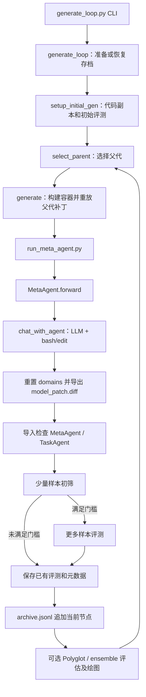

#   HyperAgents：代码架构、实验工作流与面向长程推理的研究复用

> 阅读对象：刚入学、研究 Agent 长程推理，希望用 RSI 开展 ACL 研究的研究生。  
> 分析日期：2026-10-20。  
> 本地代码：`C:/Users/刘/Desktop/RSI-Towards-LongHorizon/Project/sources/repo/HyperAgents/HyperAgents`。  
> 分析方式：静态阅读入口、核心循环、模型适配层、工具、域评测器、配置和分析脚本；未调用模型 API，未构建 Docker，未执行训练或完整基准实验，也未修改源仓库。

阅读导航：先读第1、3、4节理解系统，再读第7、8节连接论文实验；第11、12节集中讨论研究复用和判据。配套的 [Harness-Zero 分析](/C:/Users/刘/Desktop/RSI-Towards-LongHorizon/Project/analysis/Harness-Zero_代码架构与实验工作流分析.md) 解释如何把 Harness 行为转成学生权重中的能力。

## 1. 先建立正确的整体认识

**HyperAgents 的核心是：让一个可编辑的智能体程序，既执行任务，又修改产生后续智能体的程序；再用评测和版本继承把这些修改连接起来。** 主算法演化的是 Python 代码、提示词、工具使用逻辑及相关机制，基础 LLM 通过 API 提供推理能力。主循环没有更新基础 LLM 权重的 SFT、PPO 或反向传播步骤。[初始任务代理][S01]和[初始元代理][S02]都非常短；真正的实验系统分散在主循环、Git 补丁管理、Docker、各域 harness 和报表代码中。

对你的[研究笔记][NOTE]而言，它最值得借鉴的是“可继承的改进机制 + 外部验证 + 进化存档”，可以作为 $A_t\rightarrow K_t\rightarrow A_{t+1}$ 的代码演化骨架。你提出的“审查学生轨迹、蒸馏到 $M_t$ 权重、自动延长 horizon”则需要额外实现，不能直接把仓库运行起来就视为完成该闭环。

本文使用以下证据标签：

| 标签 | 含义 | 本文如何使用 |
|---|---|---|
| **代码核验** | 可以从当前本地源文件直接确认 | 参数默认值、调用链、保存路径、评分公式 |
| **README 声明** | 项目作者在说明文档中的描述 | 安装顺序、运行入口、外部日志链接 |
| **论文证据** | 同步核对本地 PDF 后整理的实验陈述 | 用章节及 PDF 页码标注，不当作本次复现实测 |
| **推断** | 从实现推出的限制或风险 | 可能的数据泄漏、控制变量不足、运行失败条件 |
| **建议** | 为你的研究提出的设计 | 长程指标、消融、接口改造，不代表仓库已有功能 |

### 1.1 模型、Agent、Meta-Agent 与 Harness 不是同一层

| 概念 | 本仓库中的实例 | 做什么 | 是否由主循环训练权重 |
|---|---|---|---|
| 基础模型 $M$ | LiteLLM 调用的 GPT、Claude 等 | 给定消息生成文字 | 否 |
| Task Agent $T_t$ | `TaskAgent.forward(inputs)` | 解题、判断论文、选择游戏动作、生成奖励函数 | 主循环修改程序，不训练基础模型权重 |
| Meta-Agent $A_t$ | `MetaAgent.forward(repo_path, eval_path, ...)` | 调工具查看并编辑代码，产生后继实现 | 自身代码可被后继继承 |
| Agent runtime / harness | `agent/`、上下文组织、工具协议、执行边界 | 把模型变成可行动的系统 | 可有部分机制被演化 |
| Evaluation harness | `domains/harness.py` 及域内评测器 | 喂任务、运行环境、算分、保存轨迹 | 设计上作为被保护的评估层 |
| 外层搜索控制器 | `generate_loop.py`、`utils/gl_utils.py` | 选父代、恢复版本、调度评测、记存档 | 主实验逻辑在容器外固定执行 |

这里有两个容易混淆的“harness”：你笔记里的 $\mathcal H$ 指 Agent 的运行时支撑；仓库 `domains/harness.py` 更多指**评测框架**。二者不能仅凭同一个文件名就等同。后者还可能调用前者来执行被测 Agent。

一个存档节点可以理解为程序组合 $H_t=(T_t,A_t,U_t)$，其中 $U_t$ 包含共同的模型适配、工具或其他辅助逻辑。后继节点继承的可以是整个程序的补丁链，不只是一个自然语言 prompt。因此，“改进器自己发生改变”有明确的结构性回返路径；但“改进器变得更强”仍要通过实验单独验证。

还要分清两个时间尺度：100代代码演化是**研究外循环的长度**，长程推理关注的是**一条任务轨迹内部的状态依赖、目标保持与错误恢复**。外循环运行很久并不会自动使paper review或IMO grading变成长程交互benchmark。

## 2. 本地快照、覆盖范围与实验资产

**代码核验：本地目录不是 Git 工作树。** `git rev-parse HEAD` 返回 `not a git repository`，根目录未见 `.git`；因此无法诚实填写上游 commit。本分析针对 2026-10-20 可见的代码快照，枚举到 145 个文件（含隐藏文件）。为方便以后判断代码是否变化，记录三个核心文件 SHA-256：

| 文件 | SHA-256 |
|---|---|
| `generate_loop.py` | `DC9951BECD15661FB454D42035F997B4D29AD38D1BB94592C58E0FE1635BEC68` |
| `meta_agent.py` | `E9215559E7F1B8269C4A31E592BACB3ED5AE0AC27C33CE5C849826DF13137BF6` |
| `task_agent.py` | `6893E337EDD074BBA0525FB114863219A9DB2E0F0800A9E54B458468207AA129` |

重点逐段核对了主循环、初始化和补丁继承、两个初始代理、工具对话循环、通用数据 harness、分类报表、BALROG 动作循环、Genesis 奖励生成与训练调度、Polyglot 任务容器、选择器、ensemble 和迁移辅助脚本。没有逐行审计所有环境渲染器、所有机器人动力学实现，也没有逐条人工核验 50 MB 的论文数据。

| 资产 | 本地情况 | 对复现的含义 |
|---|---|---|
| 主算法、工具、域封装、基线代码 | 已提供 | 可以理解完整控制流 |
| `paper_review/dataset.csv` | 已提供，50,796,201 字节 | 仍需切分脚本生成 train/val/test CSV |
| Search Arena split IDs | 已提供 | 原始数据需要从 Hugging Face 获取 |
| IMO 数据准备脚本 | 已提供 | `gradingbench/proofbench` 等 CSV 不在当前快照中 |
| Polyglot small/medium ID 列表 | 已提供 | 仍需下载基准及 SWE-bench 相关依赖 |
| `proofgrader_repo/` | 当前未提供 | IMO proof 的打分依赖它，Dockerfile 也无条件安装它 |
| `outputs/`、进化 archive、演化后的最佳程序 | 当前未提供 | 无法在本地直接重画论文曲线或检查论文最终代理 |
| 外部实验日志 | README 给出 Google Drive 链接 | 本次没有下载或验证其完整性 |
| 全部实验启动清单、固定随机种子、锁定镜像 | 不完整 | 不能用一次默认运行代替论文全部实验 |
| 主循环运行测试套件 | 未见集中覆盖的自动化测试 | `test_spec.py` 是基准规范代码，不能据文件名视为单元测试 |

[README 的日志链接与入口说明][S03]属于作者声明；“日志已经存在于本地”不成立。官方论文为[本地 HyperAgents PDF][PAPER]，代码目录之外的其他来源不纳入本次源代码覆盖范围。

另需注意，[plot_testevals.py:67][S55]的`Provided data`是写在脚本中的数值，不能把执行该脚本解释成“从本地原始实验轨迹重算了结果”。绘图代码、汇总数值和原始运行资产是三种不同证据。

## 3. 目录架构：每层为什么存在

```text
HyperAgents/
├── generate_loop.py         # 外层进化入口：初始化、选父代、生成、评测、存档
├── meta_agent.py            # 初始可自改进 MetaAgent
├── task_agent.py            # 初始通用 TaskAgent
├── run_meta_agent.py        # 容器内运行元代理、恢复评测代码、导出补丁
├── run_task_agent.py        # Polyglot 解题入口，导出对 /testbed 的代码修改
├── select_next_parent.py    # 可演化的父代选择器，默认不是主循环必用路径
├── ensemble.py              # 可演化的存档预测组合器
├── setup_initial.sh        # 初始代理评测与域准备示例
├── Dockerfile              # Python/CUDA/环境依赖镜像
├── requirements*.txt
├── agent/
│   ├── base_agent.py        # AgentSystem 抽象类与线程日志
│   ├── llm.py               # LiteLLM：模型名、调用参数、消息格式转换
│   ├── llm_withtools.py     # 文本 JSON 工具协议与多轮对话
│   └── tools/{bash,edit}.py # 执行 shell、查看/修改文件
├── utils/
│   ├── gl_utils.py          # 分数、archive、初始化、补丁、固定父代选择
│   ├── docker_utils.py      # 容器构建、挂载、文件传输、GPU、清理
│   ├── git_utils.py         # 获取版本、记录diff、恢复路径、提交副本
│   ├── domain_utils.py      # 域→分数键、split、初筛样本数等
│   └── run_*.py             # 在容器中调用 ensemble / 可演化选择器
├── domains/
│   ├── harness.py           # 通用CSV评测及域调度
│   ├── report.py            # 分类指标、IMO proof评分调度、其他域报告入口
│   ├── run_eval.py          # 固定候选补丁的独立评测
│   ├── paper_review/       # 论文录用判断数据、切分、输入格式
│   ├── search_arena/       # 偏好判断数据准备与输入格式
│   ├── imo/                # 数学评分、证明生成、评分器打包
│   ├── balrog/             # 文本游戏环境、动作循环、轨迹与进度评分
│   ├── genesis/            # 奖励函数生成→RL训练→控制策略评估
│   └── polyglot/           # 每题容器、编程补丁、测试执行
├── baselines/
│   ├── dgm/                # DGM式问题诊断与固定编程改进器
│   ├── sft_openai/         # 独立监督微调基线
│   └── ...                 # 论文审稿、IMO、机器人奖励函数基线
└── analysis/
    ├── plot_progress.py    # 进化曲线
    ├── visualize_archive.py# 父子树可视化
    ├── transfer_utils.py   # 选迁移节点、生成后续评测命令
    └── analysis_utils.py   # bootstrap区间和显著性检验工具
```

**关键架构决定：实验宿主和被演化的代码副本相分离。** [初始化函数][S04]先在输出目录建立 `gen_initial/hyperagents` 副本，排除 `outputs/`、`analysis/`、基线等；再复制当前所需的 `domains/`。它重写副本 README，让元代理知道“通过编辑程序改进下游代理，也改进产生代理的机制”。这里的 README 是运行时提示的一部分，而不只是给人的安装文档。[生成的自改进说明][S05]

外层宿主随后把这个副本以读写方式挂载到容器 `/hyperagents`；运行结束再恢复副本。因此不能把“在容器里编辑了 `generate_loop.py`”直接理解成“当前正在运行的宿主搜索循环已经被重写”。当前轮宿主仍是启动时的 Python 进程；未来补丁所改变的文件是否会参与执行，要沿实际调用路径判断。[容器挂载][S06]

## 4. 从命令入口走完一次进化

### 4.1 全局调用链



[主循环 CLI][S07]把 `--domains` 转成列表，补齐每个域的 `eval_samples` 和 subset；默认 `max_generation=10`、`eval_workers=10`、`parent_selection=score_child_prop`、`optimize_option=only_agent`。注意 Python 函数签名内部的默认值不完全相同：`generate_loop()` 的 `parent_selection` 是 `score_prop`，不能混同 CLI 默认值。[函数入口][S08]

首次运行依赖先有 `outputs/initial_<domain><subset>_0`：初始化直接 `copytree` 这些初始评测，不会自动兜底先评测。常见误读是只运行 `python generate_loop.py --domains ...` 就能从零准备所有东西；源码没有提供这种保证。

### 4.2 一代 `generate()` 的实际行为

1. 建立 `gen_<id>/` 与 `metadata`，包括父代 ID、历史和当前补丁、元代理是否成功、是否运行评测等字段。[一代入口][S09]
2. 启动挂载根副本的容器，重放父代补丁链；父代所有累积差异由 `get_patch_files()` 提供。[补丁列表][S10]
3. 把历史运行复制进 `/tmp/`。普通模式保留 archive 的训练轨迹和结果；删除 val/test 评测结果、当前节点和嵌套代码副本；`no_archive` 则仅拷贝父代目录。[历史裁剪][S11]
4. 在容器运行 `run_meta_agent.py`，传入代码路径、历史评测路径和剩余代数，最长 6 小时；Polyglot 特例使用 Claude 3.5 Sonnet 改进器。[元代理调度][S12]
5. 元代理执行之后，runner 恢复 `domains/`，收集代码差异并写 `agent_output/model_patch.diff`；新建文件也会被纳入 diff。[runner 导出补丁][S13]、[diff 实现][S14]
6. 当前补丁非空则尝试评测，同时导入 `MetaAgent` 和 `TaskAgent` 来做最低限度的可加载检查。**这是导入检查，不是行为正确性测试。** [检查代码][S15]
7. 普通域先进行少量样本初筛；所有域训练分数都非空且大于零，才扩展评测。否则保留初筛结果；`--skip_staged_eval` 跳过此初筛。[初筛与全评测][S16]
8. 清理容器并保存 `metadata.json`；外层无条件把当前 generation ID 追加到 archive，再决定哪些节点能作为后续父代。[元数据判定][S17]、[入档位置][S18]

**入 archive 不等于优于父代，也不等于验证通过。** `update_and_save_archive()` 只是追加节点；有效性、评测分数、父代采样是不同层。这样才能保留失败记录和潜在 stepping stone。把它概括成“只有表现好才入库”会误读这一实现。[archive 写入][S19]

简化伪代码如下，省略了多域、ensemble、转移实验的分支：

```python
archive = initialize_or_resume()
for generation in remaining_generations:
    parent = sample_valid_parent(archive)      # 通常基于val，有些域只有train
    restore_base_code_and_parent_patch_chain(parent)
    history = copy_training_results(archive)  # 不等于完整隔离所有评测数据
    run_inherited_meta_agent(code, history)
    reset_evaluation_domain_files()
    patch = collect_code_diff()
    if patch_is_nonempty_and_agents_import():
        run_staged_evaluation()
        if all_domain_scores_positive():
            run_larger_evaluation()
    save_patch_logs_and_metadata()
    archive.append(generation)               # 不要求当前分数高于parent
```

### 4.3 初始元代理究竟有多复杂

本地 `MetaAgent.forward()` 只构造 `Modify any part of the codebase at <repo_path>`，以 `tools_available='all'` 进入对话；**`eval_path` 与 `iterations_left` 在初始函数体内没有被使用。** 这不意味着历史不存在：历史已复制进容器，副本 README 也描述了系统目的，代理可通过工具主动探索。但源码没有把历史路径或剩余预算明确注入初始 prompt，不能把“runner 传参”写成“模型必然收到这些信息”。[初始元代理][S02]

这个极简起点恰好说明方法的研究单位：不是手工写一套精细的改进算法之后固定运行，而是给出可编辑实现和外部反馈，允许出现后继的规划、诊断、记忆、工具调用等机制。当前快照没有演化后的程序，无法仅凭这几行初始代码还原论文每个成功机制。

## 5. LLM 与工具：模型怎样真正改变代码

### 5.1 Task Agent 的默认行为

初始 `TaskAgent` 把整个 `inputs` 放入 prompt，要求返回 `<json>{"response": ...}</json>`，再从最后一条消息提取 JSON 的 `response`；失败就返回字符串 `"None"`。初始调用**不传工具列表**，而 `chat_with_agent` 默认 `tools_available=[]`，所以初始 Task Agent 实际是一个无工具的通用语言模型调用包装。[任务代理][S01]

这有两个实践意义：第一，Polyglot 要修改文件，后继程序需要获得或实现代码编辑能力，不能把初始 Task Agent 想象成现成的成熟 coding agent；第二，BALROG 每步虽复用同一个 Agent 对象，但初始 `forward` 每次都传 `msg_history=[]`，没有自动保留上一次 LLM 对话。它能看到多少历史取决于环境传入的 observation 与演化后程序自行保存的状态。

### 5.2 工具对话循环

[工具循环][S20]不是直接使用 SDK 原生 function calling，而是把工具描述写进消息，要求模型输出文本 JSON：

```json
{"tool_name": "bash", "tool_input": {"command": "..."}}
```

`check_for_tool_uses()` 用正则寻找 `<json>...</json>`，解析后由 `process_tool_call()` 按名称执行函数，把结果串回消息历史，再次请求模型。默认每条回复只执行第一个工具调用；最多 40 次实际工具调用；遇到疑似输出截断会提示重试。`load_tools()` 动态导入 `agent/tools/*.py`，符合 `tool_info()` 和 `tool_function()` 约定的模块才可注册。[工具加载][S21]

`bash` 提供命令执行，`edit` 提供文件查看、创建、替换、插入和撤回。对研究而言，`agent/llm_withtools.py` 是你实现预算控制、上下文压缩、结构化工具反馈的自然位置；`task_agent.py` 是写入目标追踪、记忆或恢复策略的直接位置。工具输出是普通文本，格式正确性和执行可靠性会影响整条长程链，不能只评最终答案而不记录失败类型。

### 5.3 模型适配层与默认值

[LLM 适配层][S22]经 LiteLLM 发起 completion，默认 temperature 为 0，最大输出预算为 16,384；对部分 GPT-5 名称跳过 temperature，并使用 `max_completion_tokens`。它转换 `text`/`content` 两种消息结构；`info` 返回空字典，未直接记录完整 token、费用和延迟。

模型配置分散而非统一 YAML：元代理 runner 默认取 `CLAUDE_MODEL`；论文审稿/Search Arena 在各自 `utils.py` 写 `gpt-4o`；BALROG 工厂使用 `OPENAI_MINI_MODEL`；Genesis 工厂使用 `CLAUDE_MODEL`；IMO 使用 `gpt-o4-mini-genai` 这类名称；Polyglot runner 使用 `o3-mini`。后两种命名不宜假定可以被当前公开 LiteLLM 环境直接解析，复现前必须核对服务端别名。[域模型配置][S23]、[游戏工厂][S24]、[机器人工厂][S25]、[IMO 配置][S26]

## 6. 数据、状态、版本与产物的生命周期

### 6.1 必须分清四种“记忆”

| 状态层 | 保存在哪里 | 何时更新 | 会不会自动成为下一轮模型上下文 |
|---|---|---|---|
| 单次工具对话历史 | `new_msg_history` | 工具调用与模型回复后 | 同次调用会；跨 `forward` 默认不会 |
| 单个环境 episode 状态 | 环境 observation、agent对象、episode日志 | 每一步动作后 | observation会被喂入；自定义agent状态需自己实现 |
| 跨代经验 | `gen_*/` 的训练预测、轨迹和日志 | 每代评测后 | 作为文件给元代理探索，不是自动全量塞入prompt |
| 可继承程序 | 根代码快照 + 有序补丁链 | 每代元代理编辑后 | 重放后成为下一代运行代码 |

**真正的进化遗传单位是补丁链。** `get_patch_files()` 直接读取节点 metadata 中 `prev_patch_files + curr_patch_files`；恢复时按顺序应用，不需要每个节点复制完整仓库。[补丁继承][S10] 这样节省空间，也意味着必须保存根快照、补丁顺序和路径；只拷贝最后一个 `model_patch.diff` 不一定能重建该节点。

### 6.2 典型输出目录

```text
outputs/generate_<run_id>/
├── archive.jsonl
├── generate_loop.log
├── gen_initial/
│   ├── hyperagents/          # 根代码副本及其Git基准
│   ├── <domain>_eval/        # 初始train评测
│   └── <domain>_eval_val/    # 仅有val的域
├── gen_1/
│   ├── metadata.json
│   ├── generate.log
│   ├── agent_output/
│   │   ├── model_patch.diff
│   │   └── meta_agent_chat_history.md
│   ├── <domain>_eval/
│   │   ├── predictions.csv
│   │   ├── report.json
│   │   └── agent_evals/chat_history_<id>.md
│   └── <domain>_eval_val/
└── gen_2/...                 # 与父代不一定线性连接
```

这是通用分类域示意；BALROG 以环境/任务/episode 保存逐步 CSV 和 JSON；Genesis 另外保存奖励函数、训练日志、控制策略相关产物；Polyglot 保存逐题代码补丁和测试输出，不能要求所有域都产出同一套文件。[分类 harness][S27]、[游戏动作与日志][S28]、[Genesis 流程][S29]、[Polyglot 流程][S30]

`metadata.valid_parent` 大致表达“有评测意图且存在可读取分数，或特殊补丁条件”，不等价于达到了显著性能改进；`parent_agent_success` 则是元代理进程退出码是否为零。一个节点“代码导入成功、元代理退出成功、产生非空补丁、评测有分数、优于父代”是五件不同的事。建议以后日志分别记录，避免把工程成功率和算法收益混在一起。

## 7. 各任务域怎样支撑论文实验

### 7.1 域接口与指标总表

| 域/CLI 名称 | Task Agent 输入和输出 | 评测逻辑 | 搜索读取的分数 | 与长程推理的关系 |
|---|---|---|---|---|
| `paper_review` | 论文文本→accept/reject | 对真实 `outcome` 做分类匹配 | `overall_accuracy` | 可能长文本，但并非自动构成长程交互 |
| `search_arena` | 两个搜索对话→偏好winner | 对数据标签做匹配 | `overall_accuracy` | 主要是评判轨迹，不是自己开展长程搜索 |
| `imo_grading` | 题目、参考解、评分标准、学生答案→等级 | 分类准确率；另报归一化MAE | `overall_accuracy` | 验证评判能力，不是过程PRM训练 |
| `imo_proof` | 数学题→证明 | 独立 proofgrader 再打四等级分 | `points_percentage` | 有推理深度，但不是形式证明验证器 |
| `balrog_babyai/babaisai/minihack/nle` | 指令、当前观察、前一动作→动作字符串 | 环境交互和任务进度 | `average_progress / 100` | 与状态依赖、多步行动最接近 |
| `genesis_go2walking/go2walkback/go2hop` | 任务、环境文件路径、默认奖励代码→奖励函数 | RL训练后按控制任务fitness评估 | `average_fitness` | LLM设计奖励，不是LLM每个物理步直接控制 |
| `polyglot` | 编程题、repo、测试说明→修改文件 | 每题容器运行单元测试 | `accuracy_score` | 代码编辑可多步，但未按依赖horizon分层 |

评分键映射、split 和 staged 样本数集中在[域元信息][S31]。`paper_review/search_arena/imo_grading` 默认有 train 与 val，传 `--eval_test` 才在每代额外评测 test；其他上述域在主循环元信息中只有 train。这是代码对 split 的命名约定，不能推导出其他域已经有严格未见任务测试。

### 7.2 通用 CSV 工作流

`domains/harness.py` 动态导入域的 `utils`，获取 `QUESTION_ID`、`MODEL` 和 `format_input_dict()`，再加载 `TaskAgent`。数据最多截取前 `num_samples` 行；每题创建新的 Agent 和聊天记录路径，线程池调用 `forward()`，最后写 `predictions.csv`。[通用评测实现][S27]

`domains/report.py` 将标签与预测小写化后做精确匹配，报告总体准确率、各类 precision/recall、标签分布和通过/失败 IDs；IMO grading 还把四个标签映射为 0/1/6/7 并计算除以7的 MAE。[分类报告][S32] 这些反馈足以让元代理检查失败案例，但并不包含你所需的“第几步发生目标偏移”“哪个 checkpoint 造成最终失败”的过程级归因。

Paper review 切分脚本按 seed 42 生成每份100例、每类50例的 train/val/test；Search Arena 按给定 IDs 取数据，过滤 tie 和非英语样本。[审稿切分][S33]、[Search Arena准备][S34] 主循环所谓 train 是搜索可用反馈集，并没有因此启动基础模型参数训练。

### 7.3 BALROG：最值得你先跟的一条长程链

`domains.harness` 分发到 `harness_balrog()`，通过工厂创建 TaskAgent；`Evaluator.run_episode` 重置环境，循环构造 `instruction/observation/prev_action`，调用 agent，校验动作，执行 `env.step()`，记录奖励和新观察，直到 terminated、truncated 或步数上限。[动作循环][S28]

这条链可以直接观察“LLM决策如何改变未来状态”。初始代理每次清空消息历史，因此演化后增加记忆、导航规划、恢复策略有清晰的切入点。不过当前配置上限和平均进度不能直接证明长依赖推理：例如重复移动很多步也可能只是局部策略。你仍需记录任务的必要依赖链、最短解长度、关键状态保持和失败恢复情况。

报表尽量用配置中应运行的 episode 数作分母，并给缺失任务补零；最终报告平均进度百分比，主搜索再除以100。[BALROG汇总][S35] 随机种子默认由时间等信息生成并记录，利于回看具体 episode，却不等价于不同方法天然使用相同的配对任务种子。

### 7.4 Genesis：不要把两层学习混成一层

LLM Task Agent 先输出 `compute_reward` 一类奖励代码；评测器保存奖励函数，然后启动 `domains.genesis.genesis_train.rl_trainer`，训练机器人控制策略，之后运行控制评估并汇总 fitness。[奖励到训练][S29]

这里有**外层代码演化**和**内层机器人 RL**：被训练的控制策略不是基础 LLM。默认配置为4096个并行环境、101次策略更新、控制评测1000步；计算成本远高于一次分类调用。[机器人配置][S36] 如果你要证明 Agent 长程推理改进，Genesis 的高 fitness 不能直接替代 LLM 长程目标维护证据。

### 7.5 Polyglot：为什么单独一套 harness

每道编程任务需要自己的语言环境和测试仓库，因而使用 `domains/polyglot/harness.py`，不是通用 CSV harness。它为题目构建容器，把演化代码复制到 `/hyperagents`，对 `/testbed` 运行 `run_task_agent.py`，拿到解题补丁，再切到测试版本执行测试。解题默认10分钟，测试默认120秒，退出码判 resolved/unresolved。[逐题处理][S30]

初筛用 `small.json`，达到0.4才评估 small+medium；总分按解决数除以预期题目数计算，错误、空补丁等另存 IDs。[Polyglot门槛][S37]、[Polyglot报告][S38] 这里有两个不同的 `model_patch.diff`：外层是“Agent程序如何改了”，内层是“Agent为某道题把目标仓库怎么改了”，阅读日志时必须通过目录辨别。

**代码与论文口径需要额外对齐。** 本地small有10项、medium有50项，`python__dominoes`重复，因此拼接列表长60但只有59个unique IDs。[small列表][S56]、[medium列表][S57] harness按`instance_id in test_task_list`筛数据，通常执行59个不同题，而报告传入`expected_num_tasks=60`，两者分母口径不一致。论文正文PDF p.7说50-task training，附录C.1（p.28–29）使用60题口径；本地实现是`>=0.4`，文字描述是more than40%。复现应固定代码版本并显式记录题ID、去重规则和门槛，不能默默混用。论文对full165题称largely unseen，不宜写成全部165题均与训练严格互斥。

## 8. 优化对象、父代选择、消融与 RSI 证据

### 8.1 哪些地方真的可以被优化

| 设置 | 代码行为 | 适合验证什么 |
|---|---|---|
| 默认 `only_agent` | 评测任务代理；允许元代理编辑可见代码 | Task Agent与改进机制联合演化 |
| `both_agent_ensemble` | 任务代理和存档组合器都参与评估 | 搜索个体与组合策略的联合收益 |
| `only_ensemble` | 对指定固定agent archive优化组合代码 | 组合机制改进；不能算个体能力提升 |
| `no_selfimprove` | 从保留的 `DONOTTOUCH` 副本执行改进器 | 固定改进器与继承改进器比较 |
| `no_archive` | 历史只给父代，并强制latest路径 | 累积存档是否有用 |
| `dgm` / `dgm_custom` | 使用DGM式固定诊断/编程改进器 | 与固定自改进流程比较 |
| `--edit_select_parent` | 在另一个容器执行可演化选择器 | 探索父代选择机制本身可否改进 |

参数选项见[CLI与消融选项][S07]；冻结改进器用保留副本工作目录实现，不能简单理解成禁止后继补丁里出现 `meta_agent.py`。[冻结工作目录][S12]

固定选择路径是 `utils.gl_utils.select_parent()`：先检查节点有效性，域有val时用val，否则用train；跨域分数做算术平均。`score_child_prop` 对分数作 sigmoid，并按已有孩子数施加惩罚，偏向有能力又未过度繁殖的节点。[固定父代选择][S39] 初筛节点的分数还会乘以域内硬编码的初筛比例；这是一种搜索启发式，不能当作原始准确率展示。[初筛分数折算][S40]

可演化路径是 `select_next_parent.py`，其**初始实现最后是均匀 `random.choice`**，不是上面同一段公式；默认不开启。论文 §3（PDF p.5）说明主实验使用固定的手工父代选择，自动编辑选择器属于 Appendix E.5 的初步探索。因此它是扩展点，不是理解主方法时必需的第三个元学习模块。[可演化选择器][S41]、[论文][PAPER]

### 8.2 三层 RSI 判据怎样落到代码与论文

你的笔记区分任务收益、保留迁移收益、改进器收益，这个区分应保留：

| 判据 | 仓库能够提供的结构 | 还应怎样验证 |
|---|---|---|
| 任务收益 | 每代task score与任务轨迹 | 固定test集、同等推理预算、多个独立run |
| 能力保留/迁移 | 补丁继承、固定节点独立评测、域迁移脚本 | 重置运行状态后测未见任务，检查旧能力退化 |
| 改进器收益 | 自身代码可被编辑并作为下一轮MetaAgent运行 | 把改进器放在相同起点与预算，比较产生后继的收益 |

**论文证据：** §5.2（PDF p.9–11）通过固定 meta-agent 的 `imp@50` 比较初始和跨域迁移改进机制；迁移到 IMO grading 报告0.630，而初始约为0，是改进器收益的直接实验线索。但迁移携带整个 agent 实现、含 task agent，不宜描述成“只换元代理、所有其他组件完全相同”的纯组件实验。§5.3（PDF p.12–13）跨运行200轮迁移的最终分数0.640对0.610，论文给出的 (p>0.05)，**不能据此宣布长期自加速已经获得统计证明**。这些是论文报告，本次未复现。[本地论文][PAPER]

代码为迁移提供 `--meta_patch_files`、`--copy_root_dir`、`--reset_task_agent` 和 `--reset_meta_agent`；不过 reset 只过滤指定文件，其他共享工具、模型适配和辅助逻辑仍可能保留变化。[迁移补丁过滤][S42] 若你的论文要做纯改进器对照，最好为task、meta、shared三组代码制定显式允许列表，而不只删一个文件的 diff。

`analysis/transfer_utils.py` 还会按绝对分数或后代增长启发式选节点；这能找候选改进器，却不能单独证明因果收益。尤其函数注释的“正增益求和”与实际代码的带符号增益平均并不相同，解读时应以函数体为准。[迁移节点选择][S43]

## 9. 复现路线与命令：以下均为静态建议，未实跑

### 9.1 先解决准备缺口

建议在独立 Linux/WSL2 工作副本中操作，因为现实现依赖 Bash、`timeout`、`find`、`patch`、Docker host networking、`/tmp` 和可选 CUDA；它不是开箱即用的原生 Windows 项目。先记录当前快照哈希，再获得带 `.git` 的完整 clone并固定commit；不要静默把重新下载的最新版本当成本次分析的同一版本。

当前快照的 `commit_repo()` 只执行 `git add/commit`，不会 `git init`。[Git提交实现][S44] 你可以在研究副本里显式建立并记录本地快照提交，或用完整上游 checkout；前者只能标为“本地基准commit”，不能冒充上游历史。

镜像准备也需先处理 `proofgrader_repo` 缺失：Dockerfile 无条件 `pip install -e proofgrader_repo`，所以README中直接 build 的顺序对于当前快照有缺口。若按全域镜像复现，先依代码脚本生成评分器包；若只跑一个域，可在独立复现分支拆分镜像依赖并记录改动。[镜像依赖][S45] 下列命令是相应准备完成后的骨架，不是保证在当前目录直接逐行成功的安装脚本。

```bash
# 在已经固定版本、有Git记录的Linux研究工作副本根目录执行
python3.12 -m venv .venv
source .venv/bin/activate
pip install -r requirements.txt
pip install -r requirements_dev.txt

# 全域镜像所需评分器包；具体依赖仍需按域准备
python -m domains.imo.setup_proofgrader_repo --proofautograder
docker build --network=host -t hyperagents .
```

API凭据按 README 放入研究工作副本的 `.env`；本次没有创建或读取凭据值。依赖文件部分Git URL、PyTorch安装未完全锁版本，模型名称也散在代码里，正式实验还应保存 `pip freeze`、镜像digest、模型版本、服务端参数与随机种子清单。[依赖文件][S46]

### 9.2 第一条建议路线：paper_review 验证外循环

它依赖最直观，适合先确认存档、补丁和分数生命周期；它不承担你的长程结论。默认 `setup_initial.sh` 仅启用该域，运行会发起模型调用。[初始脚本][S47]

```bash
python -m domains.paper_review.curate_subsets

# 先按小样本建立主循环需要的初始结果文件夹
python -m domains.harness --domain paper_review --run_id initial_paper_review_filtered_100_train_0 --subset _filtered_100_train --num_samples 10
python -m domains.harness --domain paper_review --run_id initial_paper_review_filtered_100_val_0 --subset _filtered_100_val --num_samples 10
python -m domains.report --domain paper_review --dname ./outputs/initial_paper_review_filtered_100_train_0
python -m domains.report --domain paper_review --dname ./outputs/initial_paper_review_filtered_100_val_0

python generate_loop.py --domains paper_review --run_id pilot_paper --max_generation 2 --eval_workers 2
```

`max_generation=2` 不表示只会调用两次LLM：元代理每代可多轮调工具；每代还可能有train/val两阶段评测。`--eval_samples 10` 只限制评测样本，并不完整约束元代理的token和费用。先通过实际日志建立预算估计，再扩大实验。

### 9.3 第二条路线：BALROG 接入长程评测

```bash
python -m domains.balrog.scripts.post_install
python -m domains.harness --domain balrog_babyai --run_id initial_balrog_babyai_0 --num_samples 1
python -m domains.report --domain balrog_babyai --dname ./outputs/initial_balrog_babyai_0
python generate_loop.py --domains balrog_babyai --run_id pilot_babyai --max_generation 2 --eval_workers 2
```

正式实验前为该域建立额外的固定未见任务/种子和依赖长度切分；主循环默认只有train。不要把更多episode自动称为更长horizon。建议先选一组可解释的任务，人工跟踪至少一条“观察→动作→环境→新观察”的完整轨迹。

### 9.4 固定候选、消融与迁移

```bash
# 固定改进器、去存档：建议分开独立run，并配对初始条件
python generate_loop.py --domains paper_review --run_id frozen_meta --run_baseline no_selfimprove
python generate_loop.py --domains paper_review --run_id no_archive --run_baseline no_archive

# 恢复已有run；参数应与原run匹配
python generate_loop.py --domains paper_review --resume_from ./outputs/generate_pilot_paper --max_generation 5

# 对固定候选的完整祖先补丁链做独立test评估；路径为示意
python -m domains.run_eval --domains paper_review --run_id candidate_test --copy_root_dir ./outputs/generate_pilot_paper/gen_initial/hyperagents --patch_files <ancestor_1.diff> <candidate.diff> --repeat 3

# 迁移改进机制，重置task_agent.py；不代表共享模块完全重置
python generate_loop.py --domains paper_review --run_id transfer_meta --meta_patch_files <ordered_source_patch_files> --reset_task_agent
```

`<...>` 都是待替换占位符；不要把候选最后一个diff冒充完整祖先链。`domains.run_eval` 对已存在输出目录会直接跳过，因此失败或不完整目录需要先检查，不能仅凭“进程很快结束”判断评测成功。[独立评测入口][S48]

## 10. 代码风险与潜在问题：静态发现，均未运行复现

本节只说明证据支持的具体条件，不声称论文实验受到这些问题影响。优先级表示它们对你复用/报告结论的影响。

| 优先级与问题 | 具体证据 | 触发条件及后果 | 建议处理 |
|---|---|---|---|
| 高：当前快照缺Git与初始outputs | `setup_initial_gen`拷贝初始结果并调用`commit_repo` | 直接启动主循环可能先因缺目录失败；仅补目录后仍无有效Git基准 | 在独立副本准备Git基准及完整初始评测 |
| 高：Docker构建依赖缺失包 | Dockerfile第141行无条件安装`proofgrader_repo` | 当前快照直接build可能找不到目录 | 先生成包或明确拆分域镜像 |
| 高：测试集合并器选模泄漏 | `ensemble`按当前`split`读取各节点分数选最佳 | 在test split调用默认实现时，以test分数选择agent，不能视为无偏test评价 | 固定val上选择的agent/规则，再应用于test |
| 高：评测数据的可见性隔离不足 | 副本复制选定域所有CSV，训练日志裁剪只删val/test结果 | 元代理可能读取`domains/`内带标签val/test数据；保护`domains`修改不阻止读取 | 标签/测试集放到独立评测进程，最小权限提供训练反馈 |
| 中：Polyglot跳过初筛有未定义变量 | `test_task_list`只在`if not skip_staged_eval`内赋值，随后总参与拼接 | `skip_staged_eval=True`且进入后续评测时触发局部变量未赋值 | 将small列表加载移到条件外，增加该分支验证 |
| 中：IMO ensemble支持声明与runner不一致 | 域元信息对`imo_grading`返回True；`utils/run_ensemble.py` CLI只接两个域，且导入路径不处理IMO特殊目录 | 为IMO开启ensemble时参数校验/模块导入和ID列可能不兼容 | 统一支持矩阵及question ID适配 |
| 中：Genesis把标准差标为标准误 | `np.std(fitness_scores)`保存到`standard_error` | 报告/图表如果按SE解释，会误读不确定性 | 区分std与SE并按独立重复单位重算 |
| 中：Polyglot样本去重与分母不一致 | small+medium列表有60项但59个unique ID；harness按成员关系筛题，报告用列表长度作预期数 | 完整评测实际任务数与报表分母可能不一致 | 显式去重后保存题目清单，并统一expected_num_tasks |
| 中：初始改进器未显式使用关键输入 | `MetaAgent.forward`未使用`eval_path/iterations_left` | 代理须主动发现结果和预算，实验解释不能声称prompt已含全部反馈 | 显式注入可见路径、预算和数据约束，并纳入消融 |

证据分别见[初始副本][S04]、[Git][S44]、[Dockerfile][S45]、[ensemble选择][S49]、[复制和裁剪][S11]、[Polyglot分支][S37]、[ensemble runner][S50]、[Genesis统计][S51]和[Polyglot筛题][S58]。补丁重放调用的通用日志函数会在非零退出码时抛出异常，不能误报为“失败后必然静默继续”。[patch重放][S52]、[日志错误处理][S53] 其中“代码存在某个可触发问题”和“作者论文运行触发了它”是不同命题。

另有三项影响研究设计的限制。第一，普通初筛门槛只是每域分数大于零，不与父代比较，也不做置信区间判定；容易将噪声和低门槛过筛当成进步。第二，多域平均假设不同域分数可直接相加，虽然部分指标归一化，但并未保证同等尺度或难度。第三，验证集参与多轮父代选择，会出现自适应过拟合；即使test结果不传给元代理，也仍需独立最终测试与多run估计。

## 11. 对你的循环方案：什么能复用，什么必须自建

你在笔记中提出：$A_t$ 产生私有长程harness $K_t$，在极简 $h_0$ 动作空间中审查学生轨迹，用合格数据更新 $M_t$ 与 $A_t$，然后自动延长任务horizon。HyperAgents能支撑其中的程序演化与外部评价，但没有现成实现整个数据—参数闭环。

| 你的环节 | 可以借的代码位置 | 已具备什么 | 需要自建什么 |
|---|---|---|---|
| $A_t$演化 $K_t$ | `meta_agent.py`、`generate()`、补丁继承 | 可编辑代码、容器、补丁、archive | 将学生、改进器、审查器接口与可改文件边界显式拆开 |
| 验证长程环境 $E$ | BALROG evaluator模式、域注册 | 环境reset/step、动作校验、逐步轨迹 | 隐藏测试、任务依赖图、状态快照与确定性回放 |
| checkpoint审查 | 现有循环调用`agent.forward`的位置 | 有逐步动作入口 | 审查接口、通过/替换协议、动作合法性检查和成本记录 |
| 只收有效轨迹 | `agent_evals`与episode日志模式 | 原始对话、动作、预测和结果 | 统一trajectory schema、来源追踪、审查决策标签、去污染筛选 |
| 更新 $M_{t+1}$ | 主循环没有；SFT目录只是独立基线 | 将标签数据格式化并提交SFT作业的示例 | 开源模型训练、checkpoint、采样策略、学生可见性约束 |
| 更新 $A_{t+1}$ | 程序补丁可继承 | 代码层面的改进机制演化 | 若你要更新元代理权重，需训练目标、数据构造与检查点管理 |
| 自动课程 | 当前无 | 固定任务分布和配置 | 任务生成器、难度验证、horizon调度、独立课程评测 |
| 判断改进器收益 | transfer脚本、冻结meta baseline | 候选选择与程序转移工具 | 相同学生/环境起点下的配对因果实验 |

独立SFT基线把域数据中的正确标签变成JSONL，并不提取“经过私有harness审查的完整长程轨迹”，所以不能直接充当Harness蒸馏实现。[SFT格式化][S54] 论文 §7（PDF p.14）也把固定任务分布列为限制；自动课程不是本仓库默认能力。[论文][PAPER]

建议你先把问题缩到一个可测机制，例如“演化的记忆/恢复审查器能否生成更好的长依赖轨迹，并在移除私有harness后让学生保持收益”。这比同时演化环境、课程、task agent、meta agent、审查器和基础模型更容易明确贡献与失败原因。

建议新增明确的数据协议，例如：

```python
TrajectoryStep = {
    "task_id": str, "dependency_depth": int, "step": int,
    "state_ref": str, "student_action": object,
    "audit_decision": "pass|replace|reject",
    "executed_action": object, "legal_in_h0": bool,
    "goal_state": object, "checkpoint_success": bool,
    "agent_version": str, "auditor_version": str,
    "model_checkpoint": str, "tokens": int, "latency_ms": float
}
```

这是建议，不是仓库现存schema。你尤其要保留学生原始动作和实际执行动作，否则之后无法区分“学生真学会了”和“审查器一直替学生兜底”。

## 12. 面向 ACL 的最小实验矩阵与判据

### 12.1 先把长程变量控制住

不要只用动作数或token阈值定义长程。建议为固定环境设计短/中/长依赖三档，控制每步观察格式与工具能力，改变必须记住和完成的前置条件数量、延迟反馈跨度、不可逆操作数量。记录最短有效解长度和关键子目标依赖；同时报告实际执行步数，以免“走得更久”被误当成“推理更长”。

| 指标层 | 应报告的量 | 能回答的问题 |
|---|---|---|
| 最终任务 | 各依赖档成功率、达成子目标比例、最坏档表现 | 改进是否在长依赖任务上保留 |
| 过程可靠性 | 首错位置、关键状态遗忘率、目标偏移率、非法动作率 | 收益来自哪种长程机制 |
| 恢复能力 | 注入扰动后的恢复率/恢复步数、回退成功率 | 是否只是理想轨迹表现变好 |
| 蒸馏保持 | 移除 $K_t$ 后在 $h_0$ 下的成功率 | 能力是否进入学生，而非依赖运行时审查 |
| 迁移与保留 | 未见模板/种子/环境、旧任务复测 | 是否过拟合当前课程 |
| 资源 | tokens、LLM调用、环境步、搜索/训练GPU时、墙钟时间 | 提升是否仅来自更多计算 |

### 12.2 消融不是“删掉一个组件后跑一次”

建议用配对种子和固定总预算做以下对照：

| 对照 | 固定什么 | 主要检验 |
|---|---|---|
| 初始task + $h_0$ | 模型、任务、推理预算 | 基础能力 |
| 固定手工 $K_0$ 审查/蒸馏 | 训练数据量、审查成本 | 优化harness是否优于手工规则 |
| 只演化task，冻结meta | 搜索起点与预算 | task程序搜索的收益 |
| 演化task+meta | 任务分布、评估协议 | 改进机制继承的增量 |
| 演化meta + 重置task/shared | 同一起点task、模型、环境 | 尽量单独测改进器贡献 |
| 去archive / 固定采样 | 生成候选数与成本 | 存档与父代选择是否起作用 |
| 无审查 / 只末端筛选 / checkpoint审查 | 总训练token与轨迹来源 | 分段审查是否改善信用与误差传播 |
| 无课程 / 固定课程 / 自适应课程 | 总环境交互与训练步数 | 课程收益是否独立成立 |

最后一行会引入较大研究范围，宜在前面机制成立后再做。对于“演化meta+重置task/shared”，当前`--reset_task_agent`不足以保证完整隔离，应使用显式模块清单或不同进程/包。

进一步可做一个建议性的2×2对照：$A_0/A_t\times M_0/M_t$。固定同一初始harness $K_0$、未见开发任务和生成/评测预算，分别比较“仅solver变强”“仅improver变强”“二者共同变化”。否则，若每轮都换更强的$M_t$，即便后续任务分数不断提高，也无法把增益归因给$A_t$。这组实验当前仓库没有直接实现。

### 12.3 怎样才算改进器变强

为每个候选改进器 $A$ 定义：在相同初始系统 $T_0$、环境集合和搜索预算 $B$ 下运行改进。先用验证集选择候选，再测其隐藏测试增益：

$$
\hat t(A,s)=\operatorname*{argmax}_{t\le B}J_{\mathrm{val}}(T_t^{A,s}),
\qquad
I_B(A)=\mathbb E_s\left[J_{\mathrm{test}}(T_{\hat t(A,s)}^{A,s})-J_{\mathrm{test}}(T_0)\right].
$$

若同时声称长程收益，再比较 $I_B^{\mathrm{long}}(A_t)$ 和 $I_B^{\mathrm{long}}(A_0)$，以及长短档差距、恢复指标和成本。不能逐轮查看test后取最大。报告多个独立搜索run的均值、区间和配对差异；候选数和token预算都要对齐。

“当前任务分数提高”“迁移后更容易产生好孩子”“每轮改进幅度随迭代稳定加速”是强度递增的三个主张。第三项需要跨多个迭代阶段估计成本标准化的改进速度，并排除起点、难度和预算变化；一次终局0.640对0.610且不显著，不足以支持它。优先做清楚第二项，已比仅报告任务曲线更贴近你的狭义RSI判据。

## 13. 推荐阅读路线与代码锚点索引

第一次阅读建议先跟数据走一条链，而不是从所有环境源码开始：

1. 读 `task_agent.py` 与 `meta_agent.py`：写清两者输入、输出和可改对象。
2. 读 `agent/llm_withtools.py`：手工追踪一次“模型请求→工具→反馈→再请求”。
3. 读 `generate_loop.py:427`：把一代的代码副本、补丁、历史、评测、元数据画出来。
4. 读 `utils/gl_utils.py`：确认父代选择、入档与继承的区别。
5. 用paper_review理解CSV评测，再沿BALROG动作循环理解长程交互。
6. 最后读转移和基线；把论文实验条件与本地默认设置逐项对照。

| 需要回答的问题 | 首选代码锚点 |
|---|---|
| 初始TaskAgent到底做了什么 | [task_agent.py:5][S01] |
| MetaAgent收到什么信息 | [meta_agent.py:6][S02] |
| CLI默认值与可用域 | [generate_loop.py:1025][S07] |
| 初始化、恢复及代循环 | [generate_loop.py:719][S08] |
| 单代完整过程 | [generate_loop.py:427][S09] |
| 版本补丁怎样累积 | [utils/gl_utils.py:120][S10] |
| 历史文件如何裁剪 | [generate_loop.py:363][S11] |
| 改进器与冻结副本怎样调度 | [generate_loop.py:541][S12] |
| 如何导出Agent程序差异 | [run_meta_agent.py:50][S13] |
| 工具循环与次数上限 | [agent/llm_withtools.py:91][S20] |
| LLM API、预算、模型名 | [agent/llm.py:11][S22] |
| 通用CSV评测 | [domains/harness.py:60][S27] |
| 游戏每一步怎么执行 | [domains/balrog/evaluator.py:318][S28] |
| 奖励代码怎样进入RL训练 | [domains/genesis/evaluator.py:307][S29] |
| 编程题怎样隔离和测试 | [domains/polyglot/harness.py:33][S30] |
| 各域分数和split的映射 | [utils/domain_utils.py:1][S31] |
| 固定与演化选择器区别 | [utils/gl_utils.py:511][S39]、[select_next_parent.py:14][S41] |
| 迁移时重置了哪些文件 | [utils/gl_utils.py:416][S42] |
| 独立候选测试 | [domains/run_eval.py:20][S48] |

## 14. 代码与资料链接

以下均为本机可点击的绝对路径；行号对应本次本地快照。PDF页码在正文给出，代码链接不承载论文实验的独立复现证明。

[NOTE]: /C:/Users/刘/Desktop/RSI-Towards-LongHorizon/Seminar_01/Note.md
[PAPER]: /C:/Users/刘/Desktop/RSI-Towards-LongHorizon/Project/sources/articles/HyperAgents.pdf
[S01]: /C:/Users/刘/Desktop/RSI-Towards-LongHorizon/Project/sources/repo/HyperAgents/HyperAgents/task_agent.py:5
[S02]: /C:/Users/刘/Desktop/RSI-Towards-LongHorizon/Project/sources/repo/HyperAgents/HyperAgents/meta_agent.py:6
[S03]: /C:/Users/刘/Desktop/RSI-Towards-LongHorizon/Project/sources/repo/HyperAgents/HyperAgents/README.md:50
[S04]: /C:/Users/刘/Desktop/RSI-Towards-LongHorizon/Project/sources/repo/HyperAgents/HyperAgents/utils/gl_utils.py:211
[S05]: /C:/Users/刘/Desktop/RSI-Towards-LongHorizon/Project/sources/repo/HyperAgents/HyperAgents/utils/gl_utils.py:373
[S06]: /C:/Users/刘/Desktop/RSI-Towards-LongHorizon/Project/sources/repo/HyperAgents/HyperAgents/utils/docker_utils.py:246
[S07]: /C:/Users/刘/Desktop/RSI-Towards-LongHorizon/Project/sources/repo/HyperAgents/HyperAgents/generate_loop.py:1025
[S08]: /C:/Users/刘/Desktop/RSI-Towards-LongHorizon/Project/sources/repo/HyperAgents/HyperAgents/generate_loop.py:719
[S09]: /C:/Users/刘/Desktop/RSI-Towards-LongHorizon/Project/sources/repo/HyperAgents/HyperAgents/generate_loop.py:427
[S10]: /C:/Users/刘/Desktop/RSI-Towards-LongHorizon/Project/sources/repo/HyperAgents/HyperAgents/utils/gl_utils.py:120
[S11]: /C:/Users/刘/Desktop/RSI-Towards-LongHorizon/Project/sources/repo/HyperAgents/HyperAgents/generate_loop.py:363
[S12]: /C:/Users/刘/Desktop/RSI-Towards-LongHorizon/Project/sources/repo/HyperAgents/HyperAgents/generate_loop.py:541
[S13]: /C:/Users/刘/Desktop/RSI-Towards-LongHorizon/Project/sources/repo/HyperAgents/HyperAgents/run_meta_agent.py:50
[S14]: /C:/Users/刘/Desktop/RSI-Towards-LongHorizon/Project/sources/repo/HyperAgents/HyperAgents/utils/git_utils.py:36
[S15]: /C:/Users/刘/Desktop/RSI-Towards-LongHorizon/Project/sources/repo/HyperAgents/HyperAgents/utils/gl_utils.py:608
[S16]: /C:/Users/刘/Desktop/RSI-Towards-LongHorizon/Project/sources/repo/HyperAgents/HyperAgents/generate_loop.py:637
[S17]: /C:/Users/刘/Desktop/RSI-Towards-LongHorizon/Project/sources/repo/HyperAgents/HyperAgents/generate_loop.py:705
[S18]: /C:/Users/刘/Desktop/RSI-Towards-LongHorizon/Project/sources/repo/HyperAgents/HyperAgents/generate_loop.py:924
[S19]: /C:/Users/刘/Desktop/RSI-Towards-LongHorizon/Project/sources/repo/HyperAgents/HyperAgents/utils/gl_utils.py:160
[S20]: /C:/Users/刘/Desktop/RSI-Towards-LongHorizon/Project/sources/repo/HyperAgents/HyperAgents/agent/llm_withtools.py:91
[S21]: /C:/Users/刘/Desktop/RSI-Towards-LongHorizon/Project/sources/repo/HyperAgents/HyperAgents/agent/tools/__init__.py:4
[S22]: /C:/Users/刘/Desktop/RSI-Towards-LongHorizon/Project/sources/repo/HyperAgents/HyperAgents/agent/llm.py:11
[S23]: /C:/Users/刘/Desktop/RSI-Towards-LongHorizon/Project/sources/repo/HyperAgents/HyperAgents/domains/paper_review/utils.py:1
[S24]: /C:/Users/刘/Desktop/RSI-Towards-LongHorizon/Project/sources/repo/HyperAgents/HyperAgents/domains/balrog/agents/__init__.py:21
[S25]: /C:/Users/刘/Desktop/RSI-Towards-LongHorizon/Project/sources/repo/HyperAgents/HyperAgents/domains/genesis/agents/__init__.py:27
[S26]: /C:/Users/刘/Desktop/RSI-Towards-LongHorizon/Project/sources/repo/HyperAgents/HyperAgents/domains/imo/grading_utils.py:1
[S27]: /C:/Users/刘/Desktop/RSI-Towards-LongHorizon/Project/sources/repo/HyperAgents/HyperAgents/domains/harness.py:60
[S28]: /C:/Users/刘/Desktop/RSI-Towards-LongHorizon/Project/sources/repo/HyperAgents/HyperAgents/domains/balrog/evaluator.py:318
[S29]: /C:/Users/刘/Desktop/RSI-Towards-LongHorizon/Project/sources/repo/HyperAgents/HyperAgents/domains/genesis/evaluator.py:307
[S30]: /C:/Users/刘/Desktop/RSI-Towards-LongHorizon/Project/sources/repo/HyperAgents/HyperAgents/domains/polyglot/harness.py:33
[S31]: /C:/Users/刘/Desktop/RSI-Towards-LongHorizon/Project/sources/repo/HyperAgents/HyperAgents/utils/domain_utils.py:1
[S32]: /C:/Users/刘/Desktop/RSI-Towards-LongHorizon/Project/sources/repo/HyperAgents/HyperAgents/domains/report.py:14
[S33]: /C:/Users/刘/Desktop/RSI-Towards-LongHorizon/Project/sources/repo/HyperAgents/HyperAgents/domains/paper_review/curate_subsets.py:40
[S34]: /C:/Users/刘/Desktop/RSI-Towards-LongHorizon/Project/sources/repo/HyperAgents/HyperAgents/domains/search_arena/curate_subsets.py:32
[S35]: /C:/Users/刘/Desktop/RSI-Towards-LongHorizon/Project/sources/repo/HyperAgents/HyperAgents/domains/balrog/utils.py:105
[S36]: /C:/Users/刘/Desktop/RSI-Towards-LongHorizon/Project/sources/repo/HyperAgents/HyperAgents/domains/genesis/config/config.yaml:1
[S37]: /C:/Users/刘/Desktop/RSI-Towards-LongHorizon/Project/sources/repo/HyperAgents/HyperAgents/generate_loop.py:49
[S38]: /C:/Users/刘/Desktop/RSI-Towards-LongHorizon/Project/sources/repo/HyperAgents/HyperAgents/domains/polyglot/report.py:8
[S39]: /C:/Users/刘/Desktop/RSI-Towards-LongHorizon/Project/sources/repo/HyperAgents/HyperAgents/utils/gl_utils.py:511
[S40]: /C:/Users/刘/Desktop/RSI-Towards-LongHorizon/Project/sources/repo/HyperAgents/HyperAgents/utils/gl_utils.py:32
[S41]: /C:/Users/刘/Desktop/RSI-Towards-LongHorizon/Project/sources/repo/HyperAgents/HyperAgents/select_next_parent.py:14
[S42]: /C:/Users/刘/Desktop/RSI-Towards-LongHorizon/Project/sources/repo/HyperAgents/HyperAgents/utils/gl_utils.py:416
[S43]: /C:/Users/刘/Desktop/RSI-Towards-LongHorizon/Project/sources/repo/HyperAgents/HyperAgents/analysis/transfer_utils.py:21
[S44]: /C:/Users/刘/Desktop/RSI-Towards-LongHorizon/Project/sources/repo/HyperAgents/HyperAgents/utils/git_utils.py:139
[S45]: /C:/Users/刘/Desktop/RSI-Towards-LongHorizon/Project/sources/repo/HyperAgents/HyperAgents/Dockerfile:137
[S46]: /C:/Users/刘/Desktop/RSI-Towards-LongHorizon/Project/sources/repo/HyperAgents/HyperAgents/requirements.txt:1
[S47]: /C:/Users/刘/Desktop/RSI-Towards-LongHorizon/Project/sources/repo/HyperAgents/HyperAgents/setup_initial.sh:18
[S48]: /C:/Users/刘/Desktop/RSI-Towards-LongHorizon/Project/sources/repo/HyperAgents/HyperAgents/domains/run_eval.py:20
[S49]: /C:/Users/刘/Desktop/RSI-Towards-LongHorizon/Project/sources/repo/HyperAgents/HyperAgents/ensemble.py:23
[S50]: /C:/Users/刘/Desktop/RSI-Towards-LongHorizon/Project/sources/repo/HyperAgents/HyperAgents/utils/run_ensemble.py:19
[S51]: /C:/Users/刘/Desktop/RSI-Towards-LongHorizon/Project/sources/repo/HyperAgents/HyperAgents/domains/genesis/genesis_utils.py:87
[S52]: /C:/Users/刘/Desktop/RSI-Towards-LongHorizon/Project/sources/repo/HyperAgents/HyperAgents/utils/gl_utils.py:438
[S53]: /C:/Users/刘/Desktop/RSI-Towards-LongHorizon/Project/sources/repo/HyperAgents/HyperAgents/utils/docker_utils.py:81
[S54]: /C:/Users/刘/Desktop/RSI-Towards-LongHorizon/Project/sources/repo/HyperAgents/HyperAgents/baselines/sft_openai/format_data.py:15
[S55]: /C:/Users/刘/Desktop/RSI-Towards-LongHorizon/Project/sources/repo/HyperAgents/HyperAgents/analysis/plot_testevals.py:67
[S56]: /C:/Users/刘/Desktop/RSI-Towards-LongHorizon/Project/sources/repo/HyperAgents/HyperAgents/domains/polyglot/subsets/small.json:1
[S57]: /C:/Users/刘/Desktop/RSI-Towards-LongHorizon/Project/sources/repo/HyperAgents/HyperAgents/domains/polyglot/subsets/medium.json:1
[S58]: /C:/Users/刘/Desktop/RSI-Towards-LongHorizon/Project/sources/repo/HyperAgents/HyperAgents/domains/polyglot/harness.py:286
