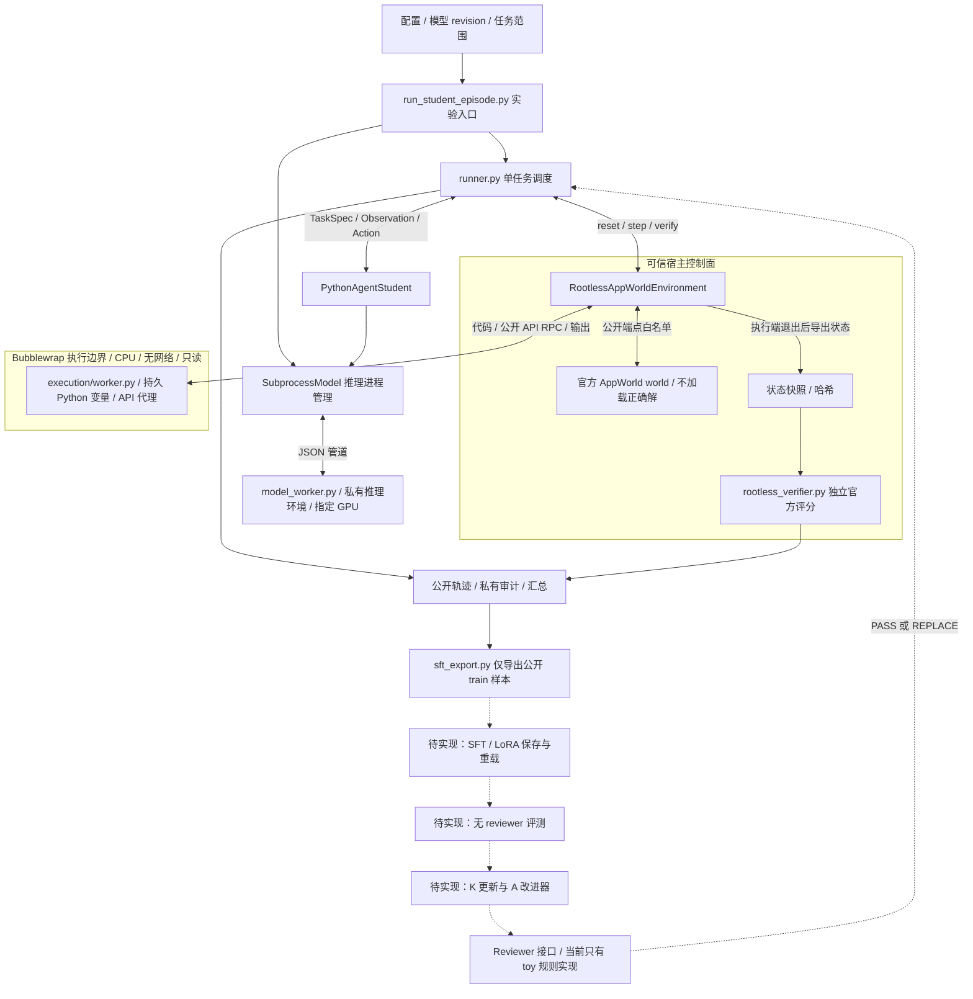
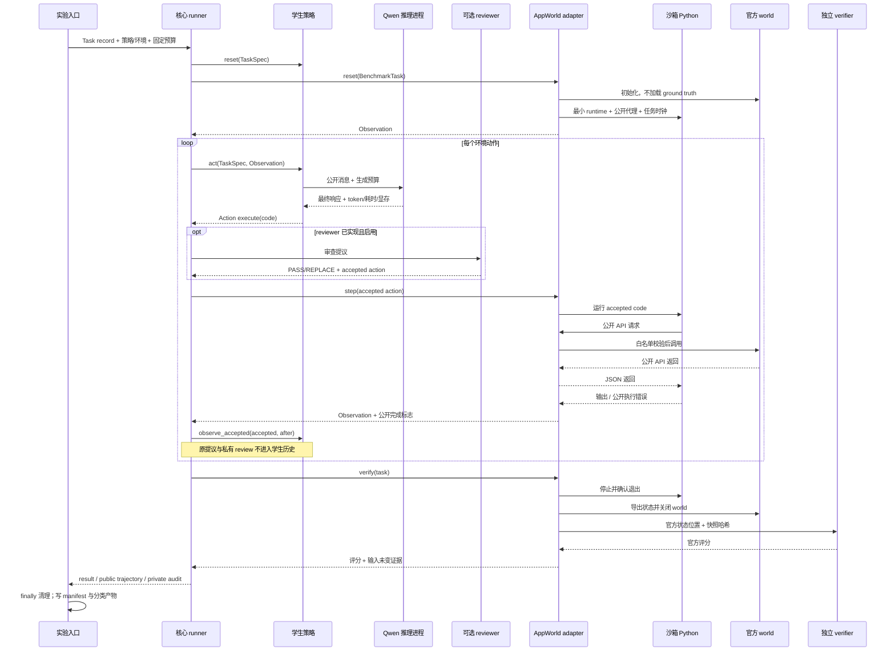
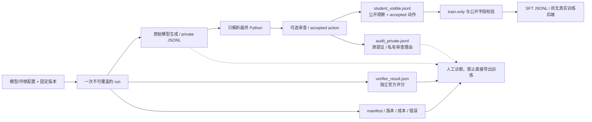

# 项目代码说明：职责、伪代码与接口数据流

**项目用一个共享 runner 组织任务，把模型推理、生成代码执行、AppWorld 状态和最终评分分开；当前训练与 RSI 外循环仍是待实现层。**

更新日期：2026-10-26。本文描述项目自己维护的 src、scripts、tests 下全部 Python/Shell 文件，以及影响运行的配置入口；不逐文件解释 sources 中两个第三方参考仓库，也不把环境依赖、缓存和生成结果当项目源码。实际运行是否通过，查 [近期 TODO](../plans/近期实验TODO.md) 与对应验收记录；“代码存在”不等于“服务器验收通过”。

## 1. 建议的阅读顺序

第一次阅读依次看 contracts.py → runner.py → model_policy.py → appworld_rootless.py → execution/bubblewrap.py / worker.py → rootless_verifier.py，最后看 run_student_episode.py 如何把它们接起来。

本项目有两条入口：toy demo 用于快速检查接口，真实 AppWorld 路线用于环境和学生实验。二者共享契约和 runner。不要把 DriftStudent 或 RuleReviewer 的确定性行为理解成真实模型能力。

如果先不看实现细节，可以把一次实验理解成五个角色：实验入口读取配置并启动资源；runner 决定下一步该轮到谁；学生策略把公开任务发给模型并提取 Python 动作；环境 adapter 把动作交给执行端，再把公开结果返回；独立评分器在交互结束后判断任务是否完成。学生反复看结果、继续行动，就是这里的一个 episode。这个交互循环本身不会更新权重，训练是后面的独立阶段。

按目录看，src 是可复用的积木，scripts 是把积木组装起来的启动命令，configs 固定本次使用的模型、任务与预算，tests 检查接口和错误边界，runs 保存每次真实执行的证据。一个 Python 文件有时只定义类或函数，被启动脚本导入后才工作，并不需要每个文件都单独运行。


## 2. 整体架构图

实线是已实现的代码关系；虚线是尚未完成的真实训练/RSI 扩展。是否有模型运行证据，以验收记录为准。



模型权重在可信推理进程中，生成的 Python 不在其中执行。评分器在另一个可信进程中；执行沙箱看不到原始数据库、评分资产和模型进程。Bubblewrap 与宿主共享内核，这个图不代表虚拟机级隔离。

## 3. 核心源码逐文件说明

下表路径均相对于 Project。Python 包根为 src/rsi_horizon。

| 文件 | 职责与关键接口 | 输入 → 输出 / 边界 |
|---|---|---|
| [src/rsi_horizon/__init__.py](../../src/rsi_horizon/__init__.py) | 包说明与导出边界 | 导入包不启动实验 |
| [contracts.py](../../src/rsi_horizon/contracts.py) | 定义 TaskSpec、BenchmarkTask、Observation、Action、StepOutcome、ReviewDecision、TrajectoryStep、EpisodeResult、ArtifactRef | dataclass 契约；公开 Observation 递归拒绝私有字段 |
| [benchmark.py](../../src/rsi_horizon/benchmark.py) | load_manifest 校验 TOML、任务 ID、split、步数、去重，并计算来源哈希 | TOML → manifest + BenchmarkTask 列表；私有记录不给策略 |
| [environment.py](../../src/rsi_horizon/environment.py) | Environment 协议和 ToyStateChain | reset/step/verify；toy 用状态链测试错误与恢复 |
| [policies.py](../../src/rsi_horizon/policies.py) | StudentPolicy 协议、DriftStudent、StudentActionError | task/observation → action；格式/上下文预算错误与基础设施错误区分 |
| [reviewers.py](../../src/rsi_horizon/reviewers.py) | Reviewer 协议与 RuleReviewer | 提议 + 公开上下文 → PASS/REPLACE；当前规则只适用于 toy |
| [runner.py](../../src/rsi_horizon/runner.py) | run_episode 调度策略、可选 reviewer、动作校验、执行、独立评分；write_episode / run_manifest 写产物 | 公开轨迹只存 accepted_action；私有审计保留 original_action 和 review；可选 observe_accepted 回调 |
| [model_policy.py](../../src/rsi_horizon/model_policy.py) | SubprocessModel 管理推理子进程；PythonAgentStudent 构造公开消息；parse_python_response 提取最终代码 | 消息 → 模型响应 → execute(code)；不执行未闭合 thinking、多个代码块或非法语法；上下文只追加已接受动作 |
| [sft_export.py](../../src/rsi_horizon/sft_export.py) | export_sft_jsonl 将公开 train 轨迹转为规范样本 | 历史 + 当前公开观察 → accepted target_action；拒绝私有字段和非 train；不进行训练 |
| [cli.py](../../src/rsi_horizon/cli.py) | toy 命令行，组织 bare/reviewed 对比和 export-sft | 参数 → toy 运行目录或训练 JSONL；不是 AppWorld 学生入口 |
| [execution/__init__.py](../../src/rsi_horizon/execution/__init__.py) | 执行后端包边界 | 导入时不创建进程 |
| [execution/bubblewrap.py](../../src/rsi_horizon/execution/bubblewrap.py) | SandboxProfile、seccomp、bwrap 参数、SandboxSession 生命周期与管道 RPC | 校验工具哈希 → 启动最小执行端 → API 调度/输出 → 超时终止与 stop proof |
| [execution/worker.py](../../src/rsi_horizon/execution/worker.py) | 沙箱内 Python 主循环、apis/requester 代理、时间冻结、持久变量、输出截断 | 代码执行时的 API 请求发回 broker；只执行端能运行生成代码；不含官方评分器 |
| [integrations/__init__.py](../../src/rsi_horizon/integrations/__init__.py) | 参考仓库与 benchmark adapter 的包边界 | 不自动导入外部工程 |
| [integrations/appworld_rootless.py](../../src/rsi_horizon/integrations/appworld_rootless.py) | public_task 安全加载任务；RootlessAppWorldEnvironment 管 world、执行端、公开端点和评分快照 | core 契约 ↔ AppWorld；load_ground_truth=False；停止后快照，再独立评分 |
| [integrations/harness_zero.py](../../src/rsi_horizon/integrations/harness_zero.py) | inspect_checkout / HarnessZeroPlan 检查本地参考入口 | 路径 → 入口位置；不是调用其完整训练/Harbor 管线 |
| [integrations/hyperagents.py](../../src/rsi_horizon/integrations/hyperagents.py) | ImproverCandidate / Archive 记录候选版本、父代和评测关联 | append-only 工件谱系；不自动生成或选择下一代 |

### 核心调度伪代码

```text
run_episode(task_record, student, environment, optional_reviewer):
    student.reset(task_record.public)
    observation = environment.reset(task_record)
    for step within fixed budget:
        proposal = student.act(task_record.public, observation)
        decision = reviewer.review(...) if reviewer enabled and budget remains
        accepted = decision.accepted_action or proposal
        append proposal / accepted / private review to private audit
        validate accepted against environment schema
        outcome = environment.step(accepted)
        append public before / accepted / public after to trajectory
        student.observe_accepted(accepted, outcome.observation) if supported
        observation = outcome.observation
        if public submission says done: break
    final_score = environment.verify(task_record)
    return result, public_trajectory, private_audit

on StudentActionError: return task failure; do not pretend environment broke
on other exception: return infrastructure error for separate diagnosis
caller always closes environment and inference backend in finally
```

注意：run_episode 会返回内存对象，不直接保存每个产物。write_episode 写公开/私有日志；真实 launcher 补配置、模型信息、GPU 快照、最终评分和失败分类。run_manifest 是 toy 批运行便利函数，当前真实 AppWorld 的资源清理由专门 launcher 负责。

## 4. 运行与部署脚本逐文件说明

### 4.1 通用准备与基础环境

| 文件 | 职责 | 关键限制 |
|---|---|---|
| [scripts/run_demo.py](../../scripts/run_demo.py) | 设置本地 src 路径并调用 cli.main | 不需要安装项目包，默认仍是 toy |
| [scripts/server/prepare_deployment.py](../../scripts/server/prepare_deployment.py) | 生成离线 Git bundle、按需参考源码快照及哈希清单 | 不打包模型、环境、凭据或运行输出 |
| [scripts/server/install_reference_snapshot.py](../../scripts/server/install_reference_snapshot.py) | 验证快照后只展开选定 AppWorld 源码与已知训练 fixture | 拒绝路径逃逸和覆盖已有目录；不是全 benchmark 数据安装 |
| [scripts/server/check_environment.py](../../scripts/server/check_environment.py) | 只读检查 Python、依赖、路径、磁盘、GPU、Docker 和数据完整条件 | Docker CLI 存在不等于 daemon 可用；缺数据时不伪报成功；当前无 Docker 入口不以其 Docker 检查作硬门槛 |
| [scripts/server/create_conda_from_cache.py](../../scripts/server/create_conda_from_cache.py) | 用公共只读缓存创建个人 Conda 环境 | 只写分配目录，不修改公共 base |
| [scripts/server/activate.sh](../../scripts/server/activate.sh) | 当前 shell 激活基础 PyTorch 环境，设置缓存和临时目录 | 不预占 GPU，不修改登录配置 |
| [scripts/server/install_gpu_smoke.sh](../../scripts/server/install_gpu_smoke.sh) | 验证离线 wheelhouse，再安装基础 GPU 软件包和做依赖检查 | 与模型推理安装分开 |
| [scripts/server/accept_gpu_environment.py](../../scripts/server/accept_gpu_environment.py) | 显式卡号/UUID 的基础计算、BF16、cuDNN、反传、写盘验收 | 小型算子测试，不证明模型可用 |

### 基础准备伪代码

```text
connected workstation:
    collect only needed code / package archives
    record revision and SHA256
    transfer to allocated server directory
server:
    verify archive and member paths
    create private Python environment
    verify package versions and dependencies
    choose an idle physical GPU only when a GPU check is needed
    run bounded compute smoke and save environment report
```

### 4.2 AppWorld 官方原生路线：可信工程对照

| 文件 | 职责 | 关键限制 |
|---|---|---|
| [scripts/server/prepare_appworld_native.py](../../scripts/server/prepare_appworld_native.py) | 在联网本地解析 Linux/Python 3.12 的 AppWorld CPU 依赖，下载离线包并记录哈希 | 与原 PyTorch 环境分开，不下载学生权重 |
| [scripts/server/bootstrap_appworld_native.sh](../../scripts/server/bootstrap_appworld_native.sh) | 安装独立 AppWorld venv，核验依赖、准备限定数据并启动原生验收 | 工程准备入口，不运行未知模型代码 |
| [scripts/server/activate_appworld_native.sh](../../scripts/server/activate_appworld_native.sh) | 激活独立 AppWorld venv 和缓存，屏蔽 GPU | source 不是沙箱 |
| [scripts/server/accept_appworld_native.py](../../scripts/server/accept_appworld_native.py) | 限定 train 任务解包、manifest、公开 API、官方解/空操作/重置检查，评分摘要和源数据哈希 | 官方解仅用于可信验收，不导出为训练数据 |
| [scripts/server/run_appworld_native.sh](../../scripts/server/run_appworld_native.sh) | 已安装后只重跑可信原生验收，保存唯一 run ID 和退出状态 | 不重复安装或覆盖旧结果 |

### 原生验收伪代码

```text
validate fixed assets and only allowed train fixture
record source file hashes
initialize world -> execute no-op -> official grade must fail
initialize world -> execute trusted official solution -> official grade must pass
initialize again -> no-op must still fail
compare public initial state and source hashes
save aggregate evidence; exclude solution source and answer-containing traces from Git
```

### 4.3 当前主路线：无 Docker 执行和独立评分

| 文件 | 职责 | 关键限制 |
|---|---|---|
| [scripts/server/prepare_bubblewrap.py](../../scripts/server/prepare_bubblewrap.py) | prepare 下载固定 Ubuntu 安全包；install 验签、验索引/软件包/二进制哈希并私有解包 | 普通用户、非 setuid；不以“哈希一致”代替签名认证 |
| [scripts/server/activate_appworld_rootless.sh](../../scripts/server/activate_appworld_rootless.sh) | 复用 AppWorld venv，换隔离 backend/缓存标记，屏蔽当前控制器 GPU | 仅 adapter 中的生成代码进入沙箱，不隔离任意 shell 命令 |
| [scripts/server/accept_appworld_rootless.py](../../scripts/server/accept_appworld_rootless.py) | 29 项执行端探针、正负例/重置/奖励伪造、源数据检查和 core runner oracle 桥接 | 有限配置的工程验收，不是学生模型评测或安全证明 |
| [scripts/server/rootless_verifier.py](../../scripts/server/rootless_verifier.py) | 独立可信进程调用官方 evaluate_task，汇总评分 | 不接收客户端 reward，不执行客户端代码；读取已停止后保存的官方状态 |
| [scripts/server/run_appworld_rootless.sh](../../scripts/server/run_appworld_rootless.sh) | 固定配置启动验收，拒绝重复 run ID，保存退出状态 | CPU/无模型，可重复验证工具链 |

### 无 Docker 执行伪代码

```text
adapter.reset(task):
    load official world without ground truth
    build public endpoint allowlist
    start bwrap client with minimal read-only runtime
    return public observation

adapter.step(execute(code)):
    validate action schema and byte budget
    client runs code in persistent namespace
    whenever apis.APP.ENDPOINT(kwargs) is called:
        send request through pipe
        controller validates public app / endpoint / quota
        trusted world executes public API and returns JSON
    return bounded stdout / public error / public completion flag

adapter.verify(task):
    stop client and verify process exit
    save official world state and hash snapshot files
    close world
    launch independent official verifier
    ensure snapshot hashes did not change during grading
    return official success and check counts
```

### 4.4 学生模型准备与真实运行

| 文件 | 职责 | 关键限制 |
|---|---|---|
| [scripts/server/prepare_student.py](../../scripts/server/prepare_student.py) | 本地下载固定模型、小文件 blob/分片 SHA256 校验；并行 Range 续传；准备 Linux 推理轮子和锁定清单 | ModelScope 可作权重传输源，但最终仍按固定官方资产哈希验收；模型不进 Git |
| [scripts/server/install_student_environment.py](../../scripts/server/install_student_environment.py) | 校验离线轮子后创建个人推理 venv，继承项目 PyTorch，安装 Transformers 并核验加载类 | 不升级公共环境或系统驱动；安装存在不等于完成模型推理验收 |
| [scripts/server/model_worker.py](../../scripts/server/model_worker.py) | 仅使用指定 GPU 的独立模型进程；离线加载 BF16 文本主干；执行 chat template、预算检查和 generate；按 ID 去除末尾 EOS/PAD 后再解码，保留 raw_text | 输入只是消息数据；不执行生成代码；拒绝隐式历史截断，记录模板哈希与 token/显存 |
| [scripts/server/run_student_episode.py](../../scripts/server/run_student_episode.py) | GPU 空闲检查、代码版本检查、模型协议 smoke、真实无 reviewer episode、独立评分、产物和资源清理 | engineering-smoke 与 baseline 明确分开；不加载官方解、不访问 test、不训练 |

### 模型准备和推理伪代码

```text
prepare_student:
    read frozen model file manifest
    fetch small files from pinned revision
    fetch weight ranges concurrently, resuming partial chunks
    assemble each shard -> verify upstream SHA256
    verify all files -> write local identity manifest

install_student_environment:
    verify every offline wheel
    create venv referencing private project's existing torch
    install only staged wheels -> pip check -> import pinned Qwen class

model_worker:
    require one explicit GPU UUID
    load local tokenizer / template / text backbone, no remote code
    emit ready metadata
    for request(messages, generation):
        apply exact template and tokenize
        if input + reserved output exceeds budget: reject, never silently truncate
        generate -> emit final text + token/time/memory statistics

PythonAgentStudent:
    build task + public observation messages
    ask worker to generate
    separate complete thinking from final answer
    parse exactly one syntactically valid Python block
    return execute(code)
    after runner accepts and executes:
        append accepted code and public result to next context
```

### 4.5 历史/后备 Docker 路线

| 文件 | 职责 | 当前地位 |
|---|---|---|
| [scripts/server/bootstrap_hz_appworld.sh](../../scripts/server/bootstrap_hz_appworld.sh) | 安装参考 Harness-Zero 的依赖，准备 AppWorld 镜像构建上下文和局部测试 | 后备，不是当前主路线的必需安装步骤 |
| [scripts/server/run_appworld_validation.sh](../../scripts/server/run_appworld_validation.sh) | 检查已准备的参考任务/镜像并运行其 oracle fixture 验证 | 依赖 Docker/Harbor；未经当前无 Docker 结果替代或证明 |

后备伪代码：准备参考依赖与任务 → 构建/确认镜像 → 调官方/攻击 fixture → 保存隔离与评分结果。当前未走这条完整路线，不能因脚本存在就认为 Docker 已可用。

## 5. 测试文件逐文件说明

| 文件 | 覆盖的核心风险 | 测试方式 |
|---|---|---|
| [tests/test_mvp.py](../../tests/test_mvp.py) | toy 对比、预算、私有任务不传策略、公开字段拒绝、SFT train-only、工件不覆盖与参考接口 | 确定性端到端 + 临时目录 |
| [tests/test_environment_check.py](../../tests/test_environment_check.py) | Docker CLI/daemon 混淆、缺数据/只有 split 清单、目录检查误判 | 模拟命令和局部目录条件 |
| [tests/test_reference_snapshot.py](../../tests/test_reference_snapshot.py) | 清单篡改、目录覆盖、不当扩大参考快照范围 | 小型临时 tar 与哈希校验 |
| [tests/test_appworld_native.py](../../tests/test_appworld_native.py) | 解包路径逃逸、只取允许任务、负例误报和无测试误报 | 资产选择与评分摘要单测 |
| [tests/test_rootless.py](../../tests/test_rootless.py) | admin/私有评分请求、API 超预算、快照变化、缺 stop proof、危险挂载和 bwrap 哈希不符 | 单元边界测试；真实 namespace/seccomp 另由服务器验收检查 |
| [tests/test_model_policy.py](../../tests/test_model_policy.py) | thinking 未结束就执行代码、多代码块、非法语法、原提议进入后续历史、模型格式错被当环境错、跨平台下载锁清理与并发拒绝、EOS 解码换行误判 | fake backend + 实际 runner 分类，不需要模型权重或 GPU |

测试伪代码：构造正常/恶意/缺失输入 → 调真实解析或边界函数 → 断言拒绝发生在副作用之前；对关键日志路径跑小型闭环。单元测试通过不替代真实模型加载、GPU 运行或完整 benchmark 评测。

```powershell
python -m unittest discover -s tests -v
```

## 6. 配置和产物也属于接口

| 配置 | 负责固定什么 |
|---|---|
| [configs/toy_benchmark.toml](../../configs/toy_benchmark.toml) | toy 任务、split、步数与状态链，用于 demo |
| [configs/server/appworld_rootless_p0.toml](../../configs/server/appworld_rootless_p0.toml) | 当前单任务、AppWorld/data 版本、沙箱路径、工具哈希与执行预算 |
| [configs/models/qwen35_9b.toml](../../configs/models/qwen35_9b.toml) | 模型/revision/加载类、推理环境、上下文、正式候选与 smoke 解码设置 |
| [configs/models/qwen35_9b_artifacts.json](../../configs/models/qwen35_9b_artifacts.json) | 模型每个文件的上游尺寸与内容哈希 |
| [configs/server/student_inference_linux_wheels.json](../../configs/server/student_inference_linux_wheels.json) / [student_inference_py312.lock](../../configs/server/student_inference_py312.lock) | 离线推理包的精确文件和主要版本 |
| [configs/server/a100_p0_p1.toml](../../configs/server/a100_p0_p1.toml) | 总体阶段预算和条件草案；实际学生单任务以专门配置为准，TODO 字段不代表已实现 |
| [configs/server/a100.env.example](../../configs/server/a100.env.example) | shell 变量示例；不是凭据文件，不填写密钥到 Git |
| configs/server/appworld_native_p0.toml / appworld_oracle_p0.toml | 早期原生/可信 oracle 验收范围，不能用于假装学生成绩 |
| pyproject.toml | Python 项目元数据和命令入口；toy 核心保持轻依赖，服务器环境独立管理 |

真实学生 run 目录至少区分：

```text
runs/student/<run_id>/
  config_resolved.toml        当前环境配置
  student_resolved.json       模型配置与两种候选生成设置
  launch-arguments.json       本次 profile、GPU UUID 等
  environment_snapshot.json   运行前资源/平台事实
  model-ready.json            实际加载版本、类、模板哈希、初始显存
  model-artifacts-verified.json  GPU 启动前的模型全文件哈希验收
  model-smoke.json            通用格式 smoke，不是 benchmark 答案
  model-worker.log            私有推理诊断
  model-generations-private.jsonl  原始生成/预算统计；不直接当 accepted 训练数据
  episode/student_visible.jsonl   公开观察与 accepted 动作
  episode/audit_private.jsonl     原提议、accepted、review 元数据
  episode/summary.json        EpisodeResult 和工件引用
  environment/               执行退出证据、API 审计、评分状态哈希
  verifier_result.json       官方评分，不由模型输出指定
  run_summary.json           任务结果与模型调用成本
  failure_taxonomy.json      失败归因，未人工判断时明确 pending
  manifest.json              commit、源码哈希、最终状态和时间
```

若启动失败，部分文件不会生成；manifest 中记录失败阶段。不要把缺少 verifier 的失败运行补成成功分数。配置、通用 smoke 与官方任务结果是不同证据。

## 7. 接口级整体数据流

### 7.1 接口契约

| 接口 | 输入 | 输出 | 可见范围 |
|---|---|---|---|
| public_task(config) | 当前已准备的单个官方 train fixture 与版本 | BenchmarkTask，含 public TaskSpec | 完整记录仅控制器；策略只拿 public |
| StudentPolicy.reset(task) | TaskSpec | 清空策略历史 | 只有任务公开字段 |
| Environment.reset(task) | BenchmarkTask | Observation | 不含正确解或 verifier 私有状态 |
| StudentPolicy.act(task, observation) | TaskSpec + 当前公开观察 + 策略维护的 accepted 历史 | Action(name='execute', arguments={'code': ...}) | 模型只能看这些公开内容 |
| backend.generate(messages, generation) | 字符串消息与明确采样预算 | text、tokens、finish_reason、耗时、显存 | 可信推理进程；不执行生成内容 |
| Reviewer.review(task, observation, action) | TaskSpec、当前公开 Observation、提议；历史需 reviewer 自行维护 | ReviewDecision(PASS/REPLACE, accepted_action, private reason) | 决策原文留私有审计；真实 LLM reviewer 尚未实现 |
| Environment.validate_action(action, observation) | accepted Action 与当前 Observation | 错误字符串或 None | 进入执行器前校验 |
| Environment.step(action) | accepted code | StepOutcome(公开 observation、done、占位 reward、事件信息) | done 是提交状态，reward 不能代替最终评分 |
| observe_accepted(action, after) | 实际执行的 accepted action + 公开结果 | 更新下一轮学生上下文 | 不接收 original proposal 或私有 review reason |
| API broker | app / api / kwargs 的严格请求信封 | 公开 API JSON 或公开错误 | 拒绝 admin、未公开端点、评分命令和超预算请求 |
| Environment.verify(task) | 已停止执行端的官方状态快照 | 官方 success/check counts + 快照一致性证据 | 控制器侧评分；不回填到学生下一轮观察 |
| export_sft_jsonl(task, trajectory, output) | train 的 student_visible.jsonl | 按历史重建的 target_action 样本 | 不读 audit_private / verifier / test |

### 7.2 数据流图



这里真正“闭环”的是任务交互与最终评分。RSI 的“新轨迹 → 学生权重更新 → 新学生 → 更新 K/A”尚未运行，图中没有把它画成已经完成的事实。

### 7.3 文件之间怎样传数据



SFT 样本不是把模型原始文本原样拼起来：导出器按公开的 accepted 轨迹重建交互上下文。模型被替换的原提议、私有审查理由和独立 verifier 不进入训练目标。当前 AppWorld 工程配置将 training_export_allowed 标为 false；本轮不导出真实训练数据，后续须先冻结采集协议。toy 导出器可用于接口检查。

## 8. 后续改代码时从哪里下手

- 改模型或解码：先改专门模型配置和 model_worker，不动沙箱边界；新架构要重新验加载/模板。
- 改学生消息格式：改 model_policy，保持只接公开数据，并更新 accepted-history 与解析测试。
- 接真实 reviewer：实现 Reviewer 接口，验证替换后学生历史只有 accepted 动作；不把私有 K/理由塞进 Observation。
- 增加 AppWorld 任务：先扩准备 manifest 和 public_task 允许范围，再做不同 API/依赖兼容性与 reset 验收；不要直接绕过当前单任务限制。
- 改沙箱挂载、依赖、网络或资源：改 execution 与其配置，并重新跑隔离/正负例验收。
- 接训练：先做独立 SFT/LoRA 保存—重载 smoke，保持导出器只读公开 train；之后再比较 B2/B3。
- 实现多轮 RSI：在已有 Archive 上补候选生成、选择与独立下游评测，前置条件是单轮内化有证据。
